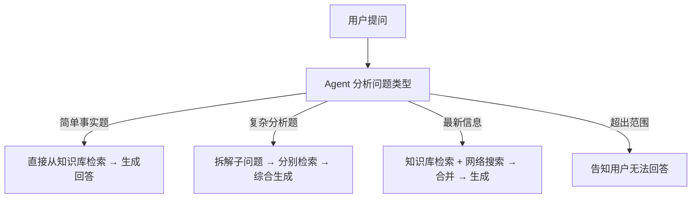

# 02 八股 · RAG 与检索

> 来源：多来源汇编（4 位作者，逐节标注来源图片编号）——@Ra哥《大模型面试突击手册》详解第 15 节、@小木同学(AI飞升之路)《普通RAG不够用：4种进阶RAG一次讲清》、@学AI可可 技术雷达 2026、@AI大模型 面试场景题。整理日期 2026-09-26。

## 本笔记导读

> 笔记约 1900 行。以下是分区导览（GitHub 上可点右上角 **Outlines** 按钮按标题跳转）。

**总览**
- 七步的大白话串讲（先建立直觉再看细节） · 为什么要有这七步——从零搭一个客服机器人的故事

**第 1 步 · 解析清洗（PDF / HTML / Excel）**
- PDF 到底是什么东西？——先跟 Markdown 对比 · 所以"读 PDF"到底在读什么——完整走一遍
- "字形对照表"到底是什么？（快递柜类比） · OCR 是什么
- 双栏怎么解 · 表格怎么解 · 扫描件与乱码 PDF
- HTML 怎么处理 · 最大的坑：代码块被清洗规则拆断
- Excel / CSV 怎么处理——和 PDF 是两个极端
- 通用清洗清单（PDF / HTML 都要做） · 工具选型 · 最重要的两条工程建议

**第 2 / 3 步 · 切块与入库**
- 第 2 步（切块）怎么落地——四种策略与 chunk_size / overlap
- 第 3 步（入库）怎么落地——embedding 到底在干什么

**在线链路：召回 / 去重 / 重排 / top-k**
- 1. 向量数据库怎么工作 · 2. 检索（召回）本身怎么工作
- 3. 去重怎么工作 · 4. 重排序算法怎么工作
- 5. top-k 与引用片段 · 6. 串起来的一个完整例子 · 第 7 步（生成）怎么落地——prompt 到底长什么样

**四种进阶 RAG（第二节）**
- 深入：C-RAG 到底怎么"质检"（论文：Corrective RAG, 2024）
- 深入：Self-RAG 的标记是"训练出来的"，不是提示词（论文：Self-RAG, ICLR 2024 杰出论文）
- 深入：RAPTOR 的树是怎么建出来的（论文：RAPTOR, ICLR 2024）
- 深入：Agentic RAG 的四种模式与工程坑

> [!info] 标注约定
> - `（整理者注）` / `> [!note] 整理者注` —— **非原帖内容**，是整理者补充
> - `【你要填】` —— 需填入你自己的真实数据（仅真题笔记的答案部分）

## 一、15. 拆解汇总、Agentic RAG（《大模型面试突击手册》，来源图片#2）

**拆解汇总**：在处理涉及多个方面的复杂问题时，RAG 的表现可能不佳，因为答案分散在文档的很多部分。

- 将一个复杂的问题拆分为多个独立子问题，利用 LLM，分别回答再融合答案。
- 对每个子问题，系统并行地从向量数据库中召回不同的内容块，对检索到的汇总片段去重，使用重排序算法处理，选出 top-k 个有用片段。
- 对汇总整理相关问题，可先检索更高级的概念，把回复作为背景信息，继续检索低层级的概念。最后，LLM 总结，产生最终答案。

**Agentic RAG**：将 RAG 嵌入在一个 Agent 循环中。适合探索性问题，可进行自主决策、多步规划和自我修正。

逻辑循环：

- **多步规划**：LLM 接收问题后，先拆解任务："我需要先查 A，再对比 B，最后计算 C。"
- **迭代检索**：执行操作 A 后，思考现有知识是否充足。如不足，自主决定去搜 github、查阅数据库还是调 API 工具。
- **自我修正**：如果检索到的信息不相关，Agent 会自动重写查询词，并进行第二轮、第三轮检索，直到找到闭环。或者检索到的信息不足时，继续进行规划和检索，直到所有推理信息都已补全。

常用工具：

- **LangGraph**：by LangChain，支持构建带"状态"和"循环"的复杂 Agent 流程，适合控制 RAG 的逻辑。

## 一·补 拆解汇总那句话里，四个环节各自怎么工作（整理者注）

> [!info] 本节为整理者补充，非原帖内容。
> 对应第一节那句："对每个子问题，系统并行地从向量数据库中召回不同的内容块，对检索到的汇总片段去重，使用重排序算法处理，选出 top-k 个有用片段。"
> 这句话压缩了四个独立环节（**召回 → 去重 → 重排 → top-k**），下面逐个展开，作为面试可复述的答法。
> 导航：`### 1` 是召回依赖的存储底座（向量库怎么做到不逐个比较），`### 2` 检索策略、`### 3` 去重、`### 4` 重排、`### 5` top-k 与引用片段、`### 6` 完整走一遍。

### 0. 先摆正位置：RAG 的完整七步

面试时不要把 RAG 讲成一条平铺的线，要分**离线索引**和**在线服务**两段——追问几乎都落在被略过的"解析"和"查询处理"上。

| 阶段   | 步骤        | 做什么                                                 | 常见坑                                |
| ---- | --------- | --------------------------------------------------- | ---------------------------------- |
| 离线索引 | 1. 解析清洗   | PDF/HTML/表格 → 纯文本，去页眉页脚、乱码、目录                       | 表格和双栏 PDF 是重灾区，解析错则后面全错            |
| 离线索引 | 2. **切块** | 固定长度 / 递归字符 / 语义 / 按标题层级；设 `chunk_size` 与 `overlap` | 切太碎丢上下文，切太大稀释语义；overlap 会造成相邻块局部重叠（**通常不去重**，见 `### 3` ⑥） |
| 离线索引 | 3. **入库** | embedding 编码 → 写向量库 → 建 ANN 索引，同时存原文与元数据            | 换 embedding 模型必须全量重建索引             |
| 在线服务 | 4. 查询处理   | 查询改写 / 拆解 / HyDE / 多路召回                             | 用户口语化、指代不清，直接用原问题召回质量差             |
| 在线服务 | 5. **召回** | 向量检索 top-N（常配 BM25 做混合检索），用 RRF 融合                  | 只靠向量会漏掉专有名词、编号、错误码                 |
| 在线服务 | 6. **重排** | 交叉编码器精排 + 去重，选 top-k                                | 重排模型与 embedding 模型不匹配时效果反而变差       |
| 在线服务 | 7. **生成** | top-k 片段编号 + 元数据拼进 prompt，约束"只依据片段回答并标注来源"          | Lost in the Middle；缺少"找不到就说不知道"的兜底 |

一句话版：**离线 = 解析 → 切块 → 向量化入库；在线 = 查询改写 → 多路召回 → 去重重排 → top-k 拼 prompt 生成。**

#### 七步的大白话串讲（先建立直觉再看细节）

> 下面各节的术语先放一边，把自己当成**图书馆管理员**：任务是"用户随便问一句话，你要从几十万页资料里找出答案"。

| 步骤 | 图书馆里对应的事 | 人话 |
|---|---|---|
| 解析清洗 | 把收到的书（扫描件、网页打印稿）整理成能读的干净文字 | 书是扫描的，先变成文字；撕掉每页的页码抬头 |
| 切块 | 把整本书剪成一页页小卡片 | 300 页没法整本塞给模型，剪成卡片才能按需取 |
| 入库 | 给每张卡片贴"主题指纹"，按指纹摆进书架 | 把内容变成一串数字，这样"哪张最像问题"能用算术算 |
| 查询处理 | 把用户的大白话问题，翻译成适合查书的说法 | "报销咋整" → "费用报销流程与所需材料" |
| 召回 | 飞快抽出一摞"可能相关"的卡片（100 张） | 要快，宁可多拿不能漏 |
| 重排 | 请专家把 100 张仔细读一遍，挑出真正有用的 5 张 | 要准，慢一点没关系 |
| 生成 | 专家根据这 5 张写答案，标注"来自某书第 3 页" | 不许瞎编，必须依据卡片，还要标出处 |

**七步的去向**：第 1 步见下节，第 2 步见再下节，第 3、4、7 步见本节后面的补充，第 5 步（召回）见 `### 2`，第 6 步（重排）见 `### 4`。

#### 为什么要有这七步——从零搭一个客服机器人的故事

> 上一节讲"每一步是什么"，这一节讲"**为什么非这么做不可**"。按遇到的问题顺序推进，名词只是顺带出现的名字。

**第 1 天：你想偷懒，把 500 份 PDF 全塞给模型**

公司有 500 份资料（员工手册、产品说明、FAQ、合同模板），几千万字。你想：全塞进 prompt 让模型自己找不就行了？

三个问题拦住你：

1. **装不下**——模型一次能读的字数有上限（叫**上下文窗口**，比如 128K token，约 10 万汉字），500 份 PDF 远超
2. **太贵**——每次提问都把几千万字发一遍，一次好几块，一天几百次就是几百块
3. **会走神**——就算装得下，模型在超长文本里会看漏中间内容（这就是 **Lost in the Middle**）

→ **所以必须切块**。把 300 页的书剪成一页页小卡片（`chunk_size`），卡片间留一点重叠防止把句子剪断（`overlap`）。

**第 2 天：卡片剪好了，怎么找到相关的那几张？**

**办法 A：关键词搜索**——搜"年假"就找含"年假"的卡片。这个老办法有个经典算法叫 **BM25**：

- 优点：快、简单，对**专有名词和编号特别准**（用户搜 `ERR_4032`，一搜一个准）
- 缺点：**换个说法就废**。用户问"我啥时候能休假"，卡片上写的是"带薪年休假享受条件"——一个字都对不上

**办法 B：按意思找**——不比对文字，比对"意思"。

→ **所以需要 embedding**：把每张卡片做一次"性格测试"，变成一串数字。意思相近，数字也相近。

> 实际场景里**两个都要**，这叫**混合检索**：BM25 管精确匹配，向量管语义匹配。

**第 3 天：10 万张卡片，每张都要跟问题算一遍相似度？**

10 万次比较要几百毫秒甚至几秒，用户等不了。

→ **所以有了 ANN 索引**：**跳过绝大多数明显不相关的卡片，只精算少数候选**。牺牲一点准确，换几十倍速度。

三种做法，**区别只在"你缺什么资源"**：

| 索引 | 一句话 | 适合谁 |
|---|---|---|
| **HNSW** | 卡片连成一张"导航图"，从入口沿越来越近的方向走 | **内存充足**，要最快最准（最主流） |
| **IVF** | 先把卡片聚类分桶，只搜最像的几个桶 | 内存吃紧，能忍慢一点 |
| **PQ** | 把卡片的数字串压缩得很短（有损） | 内存严重不足，能忍精度下降 |

> 记忆法：**HNSW 用内存换速度，IVF 用分桶省内存，PQ 用精度换内存。** 三者可叠加（IVF-PQ）。

**第 4 天：检索出一堆重复和噪声**

重复从哪来？① 切块时留了 overlap，相邻卡片本就有重叠内容；② 你同时跑了 BM25 和向量两路，两路会撞车。

→ **所以要去重**。最省事的办法：看卡片编号，同一个编号出现两次就丢一个。（详细三级去重见 `### 3`）

**第 5 天：检索出来的卡片顺序不对**

向量检索有个天生毛病：它把一整段话**压成了一个数字串**，细节丢了，所以常把"话题相关但答非所问"的排前面。

> 比如用户问"年假能结转到明年吗"，向量可能把"年假天数规定"排第一——都是年假话题，但答不了"结转"这个问题。

→ **所以要重排**：请"专家"把这 100 张仔细读一遍，重新打分排序。

**为什么不一上来就用专家？** 因为专家必须把**问题和卡片一起**送进模型（这叫**交叉编码器**），10 万张就是 10 万次现场计算。而向量检索可以**提前**把卡片算好存起来（这叫**双编码器**），查询时只算一次。

> **双编码器**：问题和卡片**分开**算，卡片能预存 → 快但粗糙 → 用于**召回**
> **交叉编码器**：问题和卡片**拼一起**算，必须现场算 → 慢但准 → 用于**重排**

**这就是两阶段的分工**：先用便宜的筛出 100 张（求不漏），再用贵的精挑 5 张（求精准）。

**两路结果怎么合并？** BM25 给的分是 12.3，向量给的是 0.85，量纲完全不同没法相加。**RRF** 的办法是**不看分数看排名**——谁在两路里都排得靠前，谁胜出。（算例见 `### 4`）

**第 6 天：把 5 张卡片拼成 prompt**

就是前面那个模板：编号 + 来源、只依据资料、找不到就说不知道、最相关的放头尾。

**还没讲到的几个词（超短白话）**

| 名词 | 人话 | 用在什么场景 |
|---|---|---|
| **SimHash** | 给文本算一个 64 位"指纹"，越像的文本指纹越接近 | 查"同一段被切了两次"的重复 |
| **MinHash** | 估算两段文本的重合比例 | 同上，适合文本被少量增删 |
| **LSH** | 把相似指纹故意分进同一个桶，只比桶内的 | 亿级数据去重（全网网页去重） |
| **父子块检索** | 用小块去检索（准），返回它所属的大块给模型（全） | 解决"切小了没上下文、切大了搜不准" |
| **元数据过滤** | 先按权限/时间/文档类型筛，再检索 | 多租户系统、只看最新版文档 |

> 这一节是**面试复述的最佳素材**：被问"你为什么这么设计 RAG"，从"500 份 PDF 装不下"讲起，每一步都是被上一个问题逼出来的，比背架构图有说服力得多。

#### 第 1 步（解析清洗）怎么落地——PDF / HTML 具体怎么处理

> 上表说"表格和双栏 PDF 是重灾区，解析错则后面全错"，这里展开怎么解。

##### PDF 到底是什么东西？——先跟 Markdown 对比

你已经懂的：**Markdown / txt 文件里存的就是字符本身**。用记事本打开 `.md`，看到的内容就是它存的内容——"文件里存的"和"屏幕上显示的"是同一件事。所以直接读出来就是文本，不需要清理。

**PDF 完全不是这样：它存的不是文字，是绘图指令。** 它不记录"这里有一段话"，只记录"在坐标 (100, 700) 处画一个字形「年」，在 (120, 700) 处画一个字形「假」"。**它更像一份施工图纸，不是一份文稿。**

真实的 PDF 内部指令长这样（这是 PDF 的指令语言）：

```
BT /F1 12 Tf      ← 开始画文字，用 F1 字体、12 磅
100 700 Td        ← 把画笔移到坐标 (100, 700)
(Hello) Tj        ← 在这里画字符串 "Hello"
ET                ← 结束
```

注意：**里面没有"段落"这个概念，只有一个一个坐标。**

**为什么 PDF 要设计成这样**：它的目标是"在任何设备上显示得一模一样"——打印、手机、电脑，版式分毫不差。为达成这个目标，必须精确控制每个字的位置、字体、字号，于是天然就是"坐标 + 字形"模式，而不是"文本流"模式。

| | 它记录什么 | 结果 |
|---|---|---|
| Markdown / Word | **内容是什么**（这是标题、这是段落） | 怎么显示交给软件决定 |
| PDF | **画面上长什么样**（每个字在哪个坐标、什么字体） | 内容是什么，你自己猜 |

##### 所以"读 PDF"到底在读什么——完整走一遍

**第一步：页面上你看到的样子**（假设有这一页）

```
┌────────────────────────────────────┐
│ 员工手册                  （页眉）   │
│                                    │
│ 年假：入职满一年享有 5 天。           │
│ 休息日：每周六、周日。                │
│                                    │
│               第 3 页               │
└────────────────────────────────────┘
```

**第二步：PDF 文件里实际存的东西**（不是上面那个画面，而是下面这张清单）

```
(72, 780) 画 "员"
(84, 780) 画 "工"
(96, 780) 画 "手"
(108, 780) 画 "册"
(72, 700) 画 "年"
(84, 700) 画 "假"
(96, 700) 画 "："     ← 每个字一条指令，各自带坐标
...
(300, 40) 画 "第"
(312, 40) 画 "3"
(324, 40) 画 "页"
```

三个要点：

1. **每个字一条指令**，各自带坐标
2. **清单顺序是排版软件写入的顺序**，不是人阅读的顺序
3. **页眉、页码和正文长得一模一样**——都是"在某坐标画某字"，没有任何标记说明"这是页眉"

**第三步：工具读的时候做什么**

工具（如 `pdfplumber`）做的事是：把上面这张清单**从头到尾走一遍**，把每个字按坐标摆到一张"隐形网格"上，然后**从上到下（y 从大到小）、同一行内从左到右（x 从小到大）**把字拼成行。这一步就叫**文本抽取**。

**第四步：抽出来是什么样**

```
员工手册
年假：入职满一年享有 5 天。
休息日：每周六、周日。
第 3 页
```

看起来还行？**因为这是单栏、简单排版。换成双栏就崩。**

**第五步：双栏为什么崩**

页面视觉上是这样：

```
┌──────────────────────────────────┐
│ 年假：入职满一年   休息日：每周六、 │
│ 享有 5 天。        周日。         │
└──────────────────────────────────┘
```

而 PDF 里的指令顺序是这样的（排版软件是**一行一行**画的）：

```
(72, 700) 画 "年"     ← 左栏第 1 行
(84, 700) 画 "假"
      ...
(400, 700) 画 "休"    ← 先画完左栏第 1 行，再画右栏第 1 行
(412, 700) 画 "息"
      ...
(72, 672) 画 "享"     ← 再回头画左栏第 2 行
(84, 672) 画 "有"
      ...
(400, 672) 画 "周"    ← 右栏第 2 行
```

工具按坐标整理时，**y=700 这一行上同时有左栏和右栏的字**，于是拼成：

```
年假：入职满一年　休息日：每周六、
享有 5 天。　　　　周日。
```

**这就是"阅读顺序丢了"**——PDF 里根本没记录"先读完左边，再读右边"这件事。

**第六步："清理"到底在清什么**

清理不是重新去读 PDF，而是**在抽出来的文字上做补救**：

| 问题 | 清理动作 | 靠什么判断（这就是"猜"） |
|---|---|---|
| 每行都是硬换行 | 删掉段落内的换行，只留段落之间的 | 行尾有没有标点、下一行有没有缩进 |
| 页眉页脚混进正文 | 找出每页重复出现的那几行，删掉 | 在多个页面反复出现 → 判定为页眉/页脚 |
| 双栏交错 | 先切栏，再各自按顺序排 | 字符 x 坐标的分布（双峰）或用布局模型 |
| 表格散架 | 找出横竖线，还原成格子 | 检测线段并求交点 |

**核心在第三列**：因为 PDF 没告诉你结构，**你只能靠规律和统计去猜**。猜得准不准，就是所谓的"解析质量"。

**四类问题汇总**

| PDF 里缺什么 | 抽出来就变成 | 俗称 |
|---|---|---|
| 段落标记 | 每行都是硬换行，段落边界丢失 | 断行问题 |
| 阅读顺序（只有绘制顺序） | 双栏内容交错，读不通 | 双栏问题 |
| 表格结构（只有横竖线） | 一堆散字，不知哪字在哪格 | 表格问题 |
| 页眉页脚也只是"画上去的字" | 和正文混在一起 | 页眉页脚污染 |

**所以"清理"的意思是**：把翻译出来的那串字，**重新推断出它原本的结构**——哪里是段落、哪里是表格、哪里是页眉。

**为什么"解析错则后面全错"**

后面每一步都建立在这些文字上：

- 段落边界猜错 → 切块位置就错 → 卡片内容只剩半句话
- 页眉混进来 → 每张卡片都带"员工手册"几个字 → 检索时这些字到处出现、干扰排序
- 表格散架 → 表里的数据变成一串乱字 → 检索不到，模型也读不懂

**文字层错了，上层怎么调都没用。** 这就是这一步值得单独花时间的原因。

**一个直观例子（这就是"双栏是重灾区"的具体样子）**

原文是双栏排版：

```
左栏：                  右栏：
年假：入职满一年        休息日：每周六、
享有 5 天。             周日。
```

PDF 的绘制顺序可能是「左栏第 1 行 → 右栏第 1 行 → 左栏第 2 行 → 右栏第 2 行」。直接抽取得到：

```
年假：入职满一年
休息日：每周六、
享有 5 天。
周日。
```

完全读不通。

**中文还有个额外的坑**：PDF 里中文字往往不存字符本身，只存**字形编号**（"年"可能存成编号 2341），要靠字体文件里的对照表还原。对照表丢失（字体子集化）时，抽出来全是 `(cid:123)` 这类乱码，只能改走 OCR。

##### "字形对照表"到底是什么？（快递柜类比）

先搞清楚一个词：**字形 = 一个字画出来的样子**。比如"年"这个字的笔画形状，就是它的字形。

**PDF 里存的是字形，不是字。** 它内部记的不是"年、假"这两个字符，而是：

- 在 (100, 700) 位置，画一个某某形状
- 在 (120, 700) 位置，画另一个某某形状

为了管理这些形状，它给每个形状编了个号，比如"年"这个形状 = **第 2341 号**。

**快递柜类比**

| 快递柜 | PDF 里对应的东西 |
|---|---|
| 柜子里的**包裹** | 字形轮廓（这字长什么样，**用来看**） |
| 柜门上的**编号 A-07** | 字形编号（内部编号） |
| 前台的**登记表**：A-07 → 张三 | ToUnicode 表（**用来查这是什么字**） |

- 你想**看**柜里有什么 → 开门就知道 → **显示正常**
- 你想**喊出收件人名字** → 必须查登记表 → **复制 / 抽取需要它**
- 登记表丢了 → 包裹还在，名字喊不出来 → **显示正常，复制出来是乱码**

**为什么这张表经常丢**

因为**文字抽取本来就不是 PDF 的主业**。

PDF 是从印刷排版行业来的，核心任务是"把版面精确印出来"——关心的是"形状画在哪"，从来不是"这个字叫什么"。能复制文字是**后来补上的功能**，靠的就是额外加的 ToUnicode 表。制作 PDF 的软件如果没把这步做全，表就缺了。

**`(cid:123)` 就是在说**："我在第 123 号柜里找到了东西，但登记表上没有它，我不知道它叫什么名字。" cid = character ID。

**怎么办**：查不了登记表，就换办法——**把页面当照片，让 OCR 去认字**（相当于不认识名字，那就看脸认人）。

**三种 PDF 的区别**

| 类型 | 柜里有包裹吗 | 有登记表吗 | 结果 |
|---|---|---|---|
| 正常 PDF | 有 | 有 | 显示正常，能复制 |
| 缺 ToUnicode 的 PDF | 有 | 无 | **显示正常**，复制是乱码 → 走 OCR |
| 扫描件 PDF | 无（整页就是一张照片） | 无 | 显示正常，什么都抽不出来 → 走 OCR |

##### OCR 是什么

OCR = Optical Character Recognition，**光学字符识别**，白话就是**让电脑"看图认字"**。

前面讲的"文本抽取"本质是**从 PDF 里复制粘贴**——因为 PDF 里存了字形指令，翻译一下就是文字。

**OCR 是另一条完全不同的路**：不管 PDF 里存了什么，先把页面**渲染成一张图片**，然后让模型像人一样**看图，把图上的字一个个认出来**。

> 类比：文本抽取 = 从电子稿里复制粘贴；OCR = 把稿子打印出来、拍张照片、照着照片一个字一个字打出来。

**什么时候必须用 OCR**

1. **扫描件**：纸质文件扫描成的 PDF，里面**根本没有文字指令**，整页就是一张图片，图片里的字是像素、不是字符。判断方法：抽取出的文本量 ÷ 页数太小，就说明是扫描件
2. **字形编号对照表丢失**：PDF 里有文字指令，但存的是编号、没有对照表还原，抽出来全是 `(cid:123)`

**OCR 的代价（为什么它不受欢迎）**

| 代价 | 具体表现 |
|---|---|
| **会认错字** | 形近字最容易混：`日`/`曰`、`末`/`未`、`0`/`O`、`l`/`1`、`土`/`士` |
| **慢** | 比文本抽取慢几个数量级 |
| **中文更难** | 笔画多、形近字多，识别率低于英文 |
| **版式要另外处理** | 认出来是一串字，位置和结构信息得靠布局模型配合 |

**为什么它直接影响 RAG 效果**

OCR 认错的字会**直接毁掉检索**：原文是"年假"，OCR 认成"年段"，用户搜"年假"就永远搜不到这一段。

所以 OCR 之后必须**抽样校对**——随机抽几页，肉眼比对原文和识别结果。

**常用工具**：PaddleOCR（中文效果好）、RapidOCR、Tesseract（老牌开源）、Surya。现代做法是 OCR + 版面分析模型一起跑，直接输出 Markdown。

**那 PDF 是不是设计得差？** 不是，是**目标不同**：PDF 要的是"精确呈现"，不是"方便机器读取"。合同、论文、报表需要版式固定，所以用 PDF；要方便处理，就该用 Markdown / HTML / Word。

##### 双栏怎么解

你要干的事：把交错的文字重新分成"先读左边，再读右边"。

**办法一：看字的位置，自己划线**

把页面上所有字的横坐标收集起来看分布。如果字集中在两个区域（比如 x=70~250 一片，x=400~580 一片），中间有片空白地带，那就是两栏——从空白处切一刀分成左右两半，每半各自从上往下排。

> 局限：只适合规规矩矩的两栏。三栏、图片穿插、表格与正文混排，它就不灵了。

**办法二：让模型看图（现在主流）**

用一个训练过的模型直接"看"这一页，像人一样告诉你：这块是标题、这块是正文、左边这列是第一栏、那个框是表格。这叫**版面分析**。

它还会告诉你**阅读顺序**（先读哪块、再读哪块），拼出来的文字就是人读的顺序。

MinerU、Marker、Docling 做的就是这件事，输出直接是 Markdown。**为什么现在都用办法二**：能处理复杂排版，而且输出的 Markdown 自带标题层级，后面切块正好用得上。

##### 表格怎么解

你要干的事：把"一堆散字"还原成"几行几列"。

- **有边框线**：最简单。找出所有横线和竖线 → 交叉形成一个个小格子 → 每个格子里有哪些字，就是那格的内容。工具：`pdfplumber.extract_tables()`、`PyMuPDF.find_tables()`
- **没画线**（很多报表是这种）：没有线只能靠**对齐**猜——同一列的字横向位置是齐的，不同列之间有一段空白。就像你看一张没有格线的价目表，也能看出哪列是商品名、哪列是价格，模型学的是同一件事
- **抽出来要转成 Markdown 或 HTML 表格**（`| 姓名 | 金额 |`），别留成"用空格对齐的纯文本"。前者明确标了哪是表头、哪是单元格，模型能理解；后者只能靠猜
- **切块时整张表作为一个整体，不许拦腰截断**
- **最难的地方其实不是解析，是检索**：表里存的是"2023 Q3 | 1.2 亿"这种碎片，用户问"去年三季度赚了多少"，这句话和表里的词**一个字都对不上**，向量检索匹配不到。解法是**给每张表生成一句"人话摘要"**——让 LLM 看一眼表格写出"本表列出 2020-2024 各季度营收数据"。检索时用摘要去匹配，命中后把**整张表**返回给模型

##### 扫描件与乱码 PDF

**先判断"这份 PDF 是不是扫描的"：看能不能抽出字。** 抽出的文字量 ÷ 页数，如果每页只有几十个字（正常一页上千字），基本就是扫描件——里面根本没有文字，只有图片。

扫描件只能上 OCR（前面讲过：把页面当图片，让电脑认字）：**PaddleOCR**（中文效果好）、**RapidOCR**、**Tesseract**、**Surya**。

另一种必须走 OCR 的情况：抽出来全是 `(cid:123)` 这种乱码——PDF 里有文字指令，但缺了字形对照表，翻译不出来。

**OCR 会认错字、直接影响检索**，所以做完必须抽几页人工核对。

##### HTML 怎么处理

比 PDF 简单得多，因为 HTML **本来就有结构**。用 `trafilatura`（专做正文抽取，最推荐）或 `readability-lxml` 剥掉导航/广告/页脚/脚本，然后**保留语义标签**：

| HTML | 转成 | 为什么 |
|---|---|---|
| `<h1>`~`<h6>` | Markdown `#`~`######` | 后面按标题层级切块 |
| `<table>` | Markdown 表格 | LLM 友好 |
| `<ul>` / `<ol>` | Markdown 列表 | 保持条目边界 |
| `<pre>` / `<code>` | 代码块 | **要保护，不能被换行规则打散** |

##### 最大的坑：代码块被清洗规则拆断

**清洗规则和代码的需求正好相反。**

清洗规则里有一条"修断行"：把段落内的换行删掉——因为 PDF 的硬换行会把一句话切断，必须拼回去。**但代码里的换行是有意义的**：

```python
def hello():
    print("hi")
    return 1
```

删掉换行和缩进后变成 `def hello(): print("hi") return 1`，**语法直接废了**（Python 靠缩进和换行区分语句）。

不只换行，其他清洗规则也在毁代码：

| 清洗规则 | 对正文是对的 | 对代码是灾难 |
|---|---|---|
| 删段落内换行 | 拼回句子 | 语法破坏 |
| 去多余空白 | 清理排版 | 吃掉缩进 |
| 多个空格压成一个 | 无关紧要 | 对齐的代码 / ASCII 图废掉 |
| 解析 `#` `*` `\|` | 识别标题 / 列表 | 代码里的 `#` 被当标题、`\|` 被当表格 |
| 去 HTML 标签 | 去广告 | 代码里的 `<tag>` 被删掉 |

**后果（为什么它算"最大的坑"）**

技术文档里的代码是**极重要的检索目标**——用户问"怎么用 Python 读 Excel"，答案往往就是一段代码。代码被拆断后：

1. **检索不到**：`pd.read_excel` 这种 token 被打碎后，向量和 BM25 都匹配不上
2. **召回后更糟**：给模型一段语法错乱的代码，它会照抄给你——**用户拿到一段跑不起来的代码，这是最坏的结果**
3. **切块被腰斩**：代码块从中间切开，前半段在 chunk 1、后半段在 chunk 2
4. **Markdown 渲染错乱**：代码里的 `#` 被解析成标题，整个结构乱掉

**怎么解决**

**① 解析阶段先识别出代码区，挖出来单独保护**

不能"一刀切"清洗。流程：先**识别**哪些区域是代码 → **挖出来一字不改** → 其余正文才走清洗规则 → 最后把代码块**放回原位**。

识别依据：

- HTML：`<pre><code>` 标签
- Markdown：三个反引号围栏
- **PDF（最难，没有标签）**：靠**字体**（代码用等宽字体 Courier / Consolas / Monaco）+ **排版特征**（行短、左边缘参差、行间空白模式相似）+ **内容特征**（`(){}[];=<>` 符号密集）

**② 清洗规则要能跳过代码区**：不删换行、不压空格、不动缩进、不解析 Markdown 符号。

**③ 切块时代码块当原子单位**：和表格一样，**一个代码块不切开**。太长就单独成块，也不切。

**④ 打类型标签**：给代码块标 `type: code`，检索时可按类型过滤（用户要"代码示例"就优先召回代码块）。

##### Excel / CSV 怎么处理——和 PDF 是两个极端

**关键认知：Excel 的结构是精确的，不需要"猜"。** `.xlsx` 文件本质是个 zip 包，里面明确记录着"第 3 行第 2 列的值是 12345"。用 `openpyxl` 或 `pandas.read_excel()` 读出来就是准确的，不存在 PDF 那种"双栏交错""表格散架"的问题。

**难点在：怎么把它变成适合检索的形式。** 四个坑：

**坑 1：一张表几千行，不能整体塞成一个块**

解法：**按行切块，但每行必须带上表头**。否则"12000"这一行脱离表头毫无意义：

```
表头：订单号 | 客户 | 金额 | 日期

第 1 行 → "订单号 A001，客户 张三，金额 12000 元，日期 2024-03-01"
第 2 行 → "订单号 A002，客户 李四，金额 8500 元，日期 2024-03-02"
```

**坑 2：数值统计问题，RAG 根本不该接**

用户问"三月份总销售额是多少"——这需要**计算**，不是检索。很多人硬用 RAG 做数值统计，效果很差。

→ 这类问题该用 **Text2SQL**：把 Excel 导入数据库，让 LLM 生成 SQL 查询，再拿结果回答（也可以只做代码执行）。

**坑 3：合并单元格、多级表头**

**场景 A：合并单元格**

现实里的表格经常长这样（"第一季度"横跨两列）：

```
┌──────┬───────┬───────┐
│      │ 第一季度       │   ← 一个合并单元格，横跨两列
├──────┼───────┼───────┤
│ 产品 │ 1月   │ 2月   │
├──────┼───────┼───────┤
│ A    │ 100   │ 120   │
└──────┴───────┴───────┘
```

但 **Excel 内部实际存的是这样**——"第一季度"只存在第一个格子里，**后面那格是空的**：

```
行1: [空]   [第一季度]  [空]     ← 第二个格子是空的！
行2: [产品] [1月]       [2月]
行3: [A]    [100]       [120]
```

**问题**：按行读出来是"空，第一季度，空"，于是 **1月、2月 这两列丢失了"属于第一季度"这个归属信息**。切块后得到"产品 A，1月 100，2月 120"——用户问"第一季度 A 多少"就可能检索不到。

**解法：向下填充（forward fill）**——把合并单元格的值**复制到它覆盖的所有格子**：

```
行1: [空]   [第一季度]  [第一季度]   ← 补上
```

**谁来填？程序填，而且能保证填对——因为"哪些格子合并了"是文件里精确记录的，不需要猜。**

xlsx 文件内部（本质是 zip 包里的 XML）会明确写出：

```xml
<mergeCells count="1">
  <mergeCell ref="B1:C1"/>
</mergeCells>
```

意思是："B1 到 C1 是一个合并区域，**值存在左上角的 B1**，C1 天生是空的。" 有了这条记录，程序能精确还原：

```python
from openpyxl import load_workbook

wb = load_workbook("报表.xlsx")
ws = wb.active

for rng in ws.merged_cells.ranges:          # 形如 "B1:C1"
    top_left = ws.cell(rng.min_row, rng.min_col).value   # 值在这个格
    for r in range(rng.min_row, rng.max_row + 1):        # 填满整个区域
        for c in range(rng.min_col, rng.max_col + 1):
            ws.cell(r, c).value = top_left
```

**为什么这样一定对**：范围是 B1:C1、值在 B1，那就把 B1 的值给 C1——**零歧义**。

**⚠️ 但用 `pandas.ffill()` 可能填错**

很多人图省事写成 `df.ffill(axis=1)`，这是**无差别填充**——把所有空值都填上，包括**本来真的是空**的格子：

```
┌──────┬───────┬───────┐
│ 产品 │ 1月   │ 2月   │
├──────┼───────┼───────┤
│ A    │ 100   │       │   ← 这个空是"2月真的没数据"，不是合并造成的
│ B    │ 200   │ 180   │
└──────┴───────┴───────┘
```

`ffill` 会把 A 的 2月填成 100（复制 1月的值）——但**事实上 A 在 2月没有数据**。这就是误填，也是"怎么保证填对"的真正风险点。

**所以要区分两类空**：

| 空的原因 | 该不该填 | 怎么识别 |
|---|---|---|
| 合并单元格造成的 | **该填** | 查 `merged_cells.ranges` |
| 数据本身缺失 | **不该填** | 不在任何合并区域里 |

**结论**：用合并区域记录精确填充，**不要无脑 `ffill`**。

**是人工还是程序**

- **程序自动**（主流）：读 `merged_cells.ranges`，可靠、可批量
- **人工改源文件**：在 Excel 里手动取消合并再导出，只适合一次性小批量

还有更根本的一条：**推动上游别用合并单元格**（导出时用"平表"，每行都完整填）。解析复杂度很多时候是上游表格设计不规范造成的，改上游比写复杂解析代码划算。

**怎么验证填对了**：在 Excel 里"取消合并"看真实值，和程序输出逐格比对；再加断言检查是否产生了不合理的重复值。

> 方向说明：合并既可能**纵向**（往下填）也可能**横向**（往右填），上面的 `rng.min_row` / `rng.min_col` 写法已同时覆盖两种情况。

**场景 B：多级表头**

两层表头的表格也很常见：

```
┌──────┬───────────────┬───────────────┐
│      │ 2023年        │ 2024年        │
├──────┼───────┬───────┼───────┬───────┤
│ 产品 │ 上半年│ 下半年│ 上半年│ 下半年│
├──────┼───────┼───────┼───────┼───────┤
│ A    │ 100   │ 120   │ 150   │ 130   │
└──────┴───────┴───────┴───────┴───────┘
```

**问题**：只看第二行，"上半年"出现了**两次**（2023 的和 2024 的）。切块后变成"产品 A，上半年 100，下半年 120，上半年 150，下半年 130"——**两个"上半年"分不清是哪个年份**，模型没法回答"2024 上半年 A 是多少"。

**解法：把多行表头拼成唯一完整的列名**：

```
产品 | 2023年-上半年 | 2023年-下半年 | 2024年-上半年 | 2024年-下半年
```

这样每列名字唯一且完整，切块后写成"产品 A，2023年-上半年 100，2024年-上半年 150"，模型才能准确回答。

**场景 C：多个 sheet 要分开处理**

一个 Excel 常有好几个 sheet：「销售数据」「库存」「客户名单」，主题完全不同。

- 分开处理，不要混成一个块
- 每块带上 sheet 名作为元数据（"来源：销售报表.xlsx → 销售数据"）
- 好处：① 用户问"库存表里…"可以按 sheet 过滤；② 回答时能准确标注出处

**坑 4：Excel 里存的是公式，不是结果**

**场景**：财务表格里你看到的是数字，但格子里存的是公式。

```
┌────────┬────────┬────────┐
│ 项目   │ 金额   │ 税后   │
├────────┼────────┼────────┤
│ 收入   │ 10000  │ 8500   │   ← 你在 Excel 里看到 8500
└────────┴────────┴────────┘
                        ↑
        这一格的"真实内容"其实是公式 =B2*0.85
```

**问题：8500 是 Excel 现算的，不是从文件里读出来的**

**Excel 里一个"算出来的格子"有三层信息。** 以"税后 = 金额 × 0.85"为例，C2 这一格：

| 层 | 内容 | 存在哪 |
|---|---|---|
| ① **公式** | `=B2*0.85` | 一定存在文件里 |
| ② **缓存值** | `8500` | **可能存在**（取决于谁保存的文件） |
| ③ **显示值** | `8500` | **不存文件**，是你打开 Excel 时现场算出来的 |

**你打开 Excel 看到的 8500 是第 ③ 层**——Excel 现场计算的结果，不是从文件里"读"出来的（这就是为什么打开大表格时偶尔会闪一下"正在计算"）。

**程序拿不到第 ③ 层**，因为 openpyxl / pandas **不会计算公式**。它只能在 ①② 里挑：

| 读法 | 拿到什么 | 什么时候失效 |
|---|---|---|
| 默认读法（`pandas.read_excel()`） | ① 公式字符串 `=B2*0.85` | 一直如此 |
| `data_only=True` | ② 缓存值 `8500` | **没有缓存值时返回 `None`** |

**② 什么时候有、什么时候没有**

| 文件怎么来的 | 有缓存值吗 | `data_only=True` 读到 |
|---|---|---|
| 人工用 Excel 编辑并保存 | **有**（Excel 保存时会把算好的结果写进去） | `8500` ✓ |
| 程序生成（openpyxl 写入公式） | **没有**（程序只写公式，不计算） | `None` ✗ |
| 程序导出纯值（pandas） | 没有公式、也没有缓存 | 直接读到值 ✓ |

**所以 `data_only=True` 不是万能解**——对"人工维护的 Excel"有效，对"程序生成带公式的文件"无效。

**根子上的原因**：**公式是给"人"用的功能，不是给"机器"用的**。人希望改了金额、税后自动更新；机器只想要最终那个数字。两者需求从一开始就不同。

**后果（回到 RAG）**：如果拿到公式字符串，切块后是"收入，10000，=B2*0.85"——用户问"税后多少钱"检索不到 8500，模型看到公式也算不出来。

**兜底方案**

- **人工维护的 Excel** → `data_only=True` 能用
- **程序生成的文件** → 写入时就存值而不是公式（`ws['C2'] = 8500`，而不是 `ws['C2'] = '=B2*0.85'`）
- 实在要算 → 用 `formulas` 之类的库自己解析并计算公式
- 或者要求上游直接导出 **CSV**（CSV 里存的纯是值，没有公式问题）

**分场景选方案**

| 你想问什么 | 该用什么 |
|---|---|
| "报销标准是多少"（查规定） | RAG（Excel 转文本块） |
| "三月份总销售额"（算数） | **Text2SQL / 代码执行，不是 RAG** |
| "张三有哪些订单"（按条件查） | Text2SQL，或 RAG 按行切块 |
| 参数对照表这类知识文档 | RAG（整表 + 摘要） |

> 面试价值：被问"Excel 怎么进 RAG"，能说出"**读取不难，难在形态转换**——按行切块要带表头、数值统计要走 Text2SQL 而不是 RAG"，比只会说"转成 CSV"高一档。

##### 通用清洗清单（PDF / HTML 都要做）

1. **去页眉页脚页码**：按跨页重复出现的频率识别后删除
2. **修断行**：PDF 硬换行会把一句话切断，段落内的换行要去掉、段落间保留（判断依据：行尾是否标点、下一行是否缩进）
3. **英文连字符拼接**：`-\n` 拼回一个词
4. **目录页**：单独标记或剔除，目录内容会污染检索
5. **字符规范化**：全角半角统一、去零宽字符与控制字符
6. **元数据提取**：标题、作者、日期、章节路径 → 存进 chunk 元数据，检索时可过滤、回答时可展示引用
7. **文档内去重**：同一文档里重复段落用 SimHash 干掉（呼应 `### 3` 去重）

##### 工具选型

| 类型 | 工具 | 特点 |
|---|---|---|
| 布局模型（首选） | **MinerU**、**Marker**、**Docling**、Nougat | 输出 Markdown，处理双栏/表格/公式；中文推荐 MinerU |
| 规则库 | `pdfplumber`（准、慢）、`PyMuPDF`（快） | 适合结构规整的数字版 PDF |
| RAG 预处理框架 | `unstructured` | 自动判定元素类型（Title/Table/ListItem），可接 OCR |
| 商业 API | Azure Document Intelligence、Textract、Document AI | 省事，按量付费 |
| HTML | `trafilatura`、`readability-lxml` | 正文抽取 |

##### 最重要的两条工程建议

1. **能不用 PDF 就别用**：原始资料若有 Markdown / HTML / Word 版本，直接用——这是绕过问题而非解决问题
2. **解析质量决定 RAG 上限**：后面的切块、检索、重排做得再好，都救不回解析错的原文。此步要**抽样人工核对**（随机抽 20 页，肉眼比对原文与抽取结果，看双栏是否交错、表格是否散架）

> 面试价值：这一段是**区分"跑过 demo"和"做过生产"**的典型题。能说出"双栏靠版面分析 + 阅读顺序预测""表格生成摘要后再检索""扫描件走 OCR 且要校对"，比背 RAG 概念管用得多。

#### 第 2 步（切块）怎么落地——四种策略与 chunk_size / overlap

> 上表说"固定长度 / 递归字符 / 语义 / 按标题层级；设 `chunk_size` 与 `overlap`"，这里逐个讲清。

**`chunk_size` 与 `overlap`**

- **`chunk_size`**：每个块多大，按字符数或 token 数计。太小（<128 token）一块说不清一件事；太大（>1024）一块混多个主题，向量被"平均"掉、语义稀释。中文常用 **300~800 字符**，英文常用 **256~512 token**，技术文档偏小（求精确）、叙述性文档偏大
- **`overlap`**：**相邻两块共享的那一段文字**。为什么需要？因为硬切会从中间劈开短语或句子，劈开后两边各自都不完整：

```
原文：RAG 的完整流程包括解析、切块、向量化入库。切块环节直接决定检索质量。

不设 overlap：
块1：RAG 的完整流程包括解析、切块、向量
块2：化入库。切块环节直接决定检索质量
      ✗ "向量化入库" 被劈开，两边都不完整

设 overlap（块2 开头重复块1 的结尾）：
块1：RAG 的完整流程包括解析、切块、向量
块2：解析、切块、向量化入库。切块环节直接决定检索质量
      ✓ "向量化入库" 在块2 里完整出现
```

- **overlap 的代价**：存储冗余（向量库变大），且相邻块内容相似、检索时可能一次召回两个高度相似的块。**但这类局部重叠通常不去重**（原因见 `### 3` ⑥）——去重主要处理的是"同一块被召回多次"
- **经验值**：overlap = `chunk_size` 的 **10%~20%**

**四种切块策略**

| 策略 | 靠什么找断点 | 特点 |
|---|---|---|
| **固定长度** | 纯字符数硬切 | 最快最笨，必然切断句子，一般只做兜底 |
| **递归字符** | 分隔符优先级，逐级降级 | **最常用**，尽力在自然边界断开 |
| **语义** | 相邻句子 embedding 相似度骤降处 | 质量最高，慢且贵，块大小不可控 |
| **按标题层级** | 文档自身的 `#` / `##` 结构 | 文档类最有效，块天然带章节路径 |

**① 固定长度（Fixed-size）**

按字符数硬切，不看内容。最简单，但必然切断句子和段落。实践中很少单独使用，多作为兜底。

**② 递归字符切块（Recursive Character Splitting）**

名字容易误解——它**不是**按字符切，而是维护一个**分隔符优先级列表**，按顺序尝试：

```
["\n\n", "\n", "。", "！", "？", "，", " ", ""]
 段落    换行  句号  叹号  问号  逗号 空格 硬切
```

逻辑：先用 `\n\n`（段落）切 → 若切出的块仍超过 `chunk_size`，就降级用 `\n` 切 → 再超就用句号 → 逗号 → 最后才按字符硬切。**"递归"指的就是这个逐级降级的过程。**

效果：优先在段落边界断、其次句子、最后才切字，最大限度保住语义完整。**实践中的默认首选**（LangChain 的 `RecursiveCharacterTextSplitter`）。

**③ 语义切块（Semantic Chunking）**

不靠标点，靠**意思**。做法：文本按句子切开 → 每句算 embedding → 计算相邻句子的相似度 → 相似度**骤降**处即话题切换点 → 在那里切。

优点：块内主题高度一致，检索精度最高。缺点：慢（要算大量 embedding）、贵、块大小不可控（可能切出超长/超短块）。用于对质量要求高的场景。

**④ 按标题层级切（Markdown / HTML 结构切块）**

利用文档自身结构：先按 `#` 一级标题切，`##` 下的内容作为一个块；块太大继续按 `###` 切。

最大好处是**每个块天然带"章节路径"**（如 `产品手册 > 安装 > 环境要求`）。把路径**拼到块内容前面**，检索时就能匹配到原本缺失的上下文；也可存进元数据做过滤。**真实文档都带层级，所以这招工程上最有效。**

**实战组合**

```
按标题层级切 → 超长的块再用递归字符切 → 加 10%~20% overlap
→ 每个块前面拼上章节路径 → 存入元数据
```

> 面试价值：被问"你怎么切块"，答"用 RecursiveCharacterTextSplitter，chunk_size 500、overlap 50"只是背参数；能补上"**为什么**要 overlap（防跨界语义被劈开）""**为什么** overlap 会导致重复召回（所以要接去重）""**什么时候**改用语义切块或标题层级切块"，才是理解到位。

#### 第 3 步（入库）怎么落地——embedding 到底在干什么

**为什么需要它**：计算机不认字、只认数字。要把"哪段文字最像用户的问题"变成计算机能算的算术题，就得先把文字变成数字。

**做法：给每段话做一次"性格测试"**

想象一份有几百道题的问卷，每道题打一个分，几百个分数连起来，就是这段文字的"性格档案"——这就是**向量**（embedding）。

关键在于**这些题不是人出的**，是模型从海量文本里自己学出来的（所以别问"第 37 维是什么意思"，没人能解释，但整体效果好）。意思相近的两段话，答题结果也接近，向量方向就一致。

**怎么判断"像不像"**：把两个向量想成两支从原点射出的箭，**夹角越小越像**。余弦相似度就是量这个夹角——夹角 0° 得 1（完全一样），90° 得 0（毫无关系）。

**维度是多少**：常见 768 / 1024 / 1536 维。实践中不必纠结选哪个，关键是**编码文档和编码问题必须用同一个模型**——否则像用两套不同的问卷打分，分数根本没法比。

**"入库"具体还干了三件事**

1. 把每张卡片的**原文 + 向量 + 元数据**（来源文件、页码、章节路径）一起存进去——元数据后面用来做过滤和展示引用
2. 建 **ANN 索引**（HNSW 那一套，详见 `### 1`），目的是不用逐个比较就能找到最近的向量
3. 换 embedding 模型 = 问卷换了一套 = 所有卡片都得重新答题，所以**必须全量重建索引**（这就是总表里那个坑）

> 常见误区：以为"入库"只是把文件塞进数据库。实际上核心是**把文字转成可比较的数字并建好索引**，向量库只是承载物。

#### 第 4 步（查询处理）怎么落地

**为什么需要它**：用户说话是口语的、带指代的、信息不全的。原话直接拿去检索会打偏。

| 手段 | 人话 | 例子 |
|---|---|---|
| **查询改写** | 口语 → 规范检索词 | "这破系统报销咋走" → "费用报销的流程与所需材料" |
| **查询拆解** | 一个问题含多个方面，拆开各自查 | "鉴权怎么做、跟上一版比改了什么" → A 当前鉴权方式 / B 版本变更 |
| **多查询扩展** | 一个问题生成几个说法，都查一遍再合并 | "年假规定" → "带薪休假制度""休假申请条件" |
| **HyDE** | 先让 LLM 编一段**假答案**，用假答案去检索 | 见下 |
| **指代消解** | 把"它""这个"替换成前文实体 | 多轮对话场景，见第四节 |

##### HyDE：先让 AI 编一份"假文档"，再去检索

**（Hypothetical Document Embeddings，假设性文档嵌入）**

**先从你每天都在用的搜索框说起**

你有没有发现：在搜索引擎里，**搜一句陈述句，比搜一个问句效果更好**？

| 你搜什么 | 效果 |
|---|---|
| "怎么报销" | 一般 |
| "员工出差费用报销流程说明" | 准得多 |

因为索引里存的都是**文档里的句子**。你搜的话越像文档里的话，越容易命中。

**HyDE 就是把这个规律自动化**：既然"像文档的话"搜得准，那就**先让 AI 写一段"假如这是文档里会写的话"**，再拿这段话去搜。

用户问"出差花的钱怎么报"，AI 先编出一段"假文档"：

```
员工出差产生的交通费、住宿费、伙食补助等，需在返回后 15 个工作日内，
填写《差旅费报销单》，附发票原件，经部门负责人审批后交财务部……
```

拿这段去检索，一下就撞上真正的《差旅费报销管理办法》。

**为什么"用问题搜不准"——用两个区来理解**

把向量空间想成一张地图，上面有两个区：

- **问句区**：所有"怎么办""是什么"这类问法都聚在这里
- **文档区**：所有资料文档都聚在这里

你的问题落在**问句区**，而答案文档在**文档区**。站在问句区去找"最近的文档"，等于**隔区测量**——两个区的形状本来就不一样（问句短、口语、信息少；文档长、书面、信息密），测出来的距离**不可比**。

假答案是用"文档的写法"写的，所以它**落在文档区**——和真文档站在同一个区里，这时候比距离才准。

> 类比：两个小区离得很远，但说的是同一件事。你按自己小区的位置去找"说这件事的人"找不到；先学会那个小区的说话方式（假答案），再去找就容易了。

**一句话：HyDE 把"问题 → 文档"的隔空比距离，换成了"文档 → 文档"的同场比距离。**

**为什么假答案内容错了也没关系——画像师类比**

你要找一个嫌疑人（真文档），手上只有目击者的口头描述（用户的问题）。

- 直接拿口头描述去比对数据库 → 比不中（描述太模糊）
- 先请**画像师画一张模拟画像**（假答案）→ 拿画像去比对 → 从数据库里筛出一批候选人

**画像不需要和真人一模一样**。只要身高、脸型、发型这些**整体特征**对，就能把范围缩小到几个人。画像把眼睛画大了一点，不影响筛选——因为你靠的是整体特征，不是细节。

同理：假答案说"报销要填 3 张表"，真文档说"填 2 张表"——**向量位置几乎一样**（都在讲报销流程）。

但假答案要是说"报销要先写代码"（完全跑题），向量就飘走了。所以要求是「**可信地错**」——细节可以错，主题和用词必须对。

**它顺便还当了个"翻译"**

用户说大白话，文档写专业术语。AI 见过大量这类文档，编假答案时会**自动用上专业术语**。于是假答案成了**用户语言 → 专业文档**之间的桥。

**完整流程**

```
用户问题："出差花的钱怎么报"
   ↓  AI 编一段假文档
假答案："员工出差产生的交通费、住宿费……填写《差旅费报销单》……"
   ↓  编码成向量
用这个向量去检索  →  命中《差旅费报销管理办法》
```

- **只用假答案搜，还是问题和假答案一起用**：原论文只用假答案；实践中常用加权混合 `v = α·问题向量 + (1-α)·假答案向量`，兼顾两者
- **编几份**：原论文编 **8 份**（每次采样略有不同），向量取平均或各自检索后融合，降低随机性
- **代价**：多一次 LLM 调用（几百毫秒到几秒），编 8 份就是 8 倍——这是它不能无脑上线的根本原因

**假答案会不会污染最终回答？——不会，它只是"钥匙"**

一个常见担心："AI 编的东西要是错的，岂不是把错答案带进最终回答？"

**不会，因为假答案只用在检索这一步，门开了它就被丢掉了。**

| 阶段 | 用的是什么 | 假答案在这里吗 |
|---|---|---|
| ① 检索 | 用**假答案的向量**当查询，去向量库找相近的**真文档** | **在这里**（只贡献"位置"） |
| ② 重排 | 对召回的**真文档**重新打分 | 不在 |
| ③ 生成 | 把**真文档**塞进 prompt 让 LLM 作答 | **不在**（早被丢掉） |

> 类比：假答案像一把**配的钥匙**。配钥匙是为了开门，门开了钥匙就没用了——你进去看的是屋里的东西（真文档），不是钥匙本身。

**所以"不用担心"是两重理由**：

1. 假答案**根本不进入生成阶段**，不可能污染答案
2. 它在检索阶段也**只贡献向量位置、不贡献事实**——内容错了无所谓，主题和用词对就行

> **注意区分（易混点）**：常说的"RAG 回答只依据自己的文档"是 **RAG 的通用约束**（prompt 里要求"只依据资料回答"），属于第三重保障，**不是 HyDE 特有的**。HyDE 的安全来自上面两条。

**什么时候有用、什么时候反而变差**

| 场景 | 有用吗 | 为什么 |
|---|---|---|
| 跨语言检索（中文问题查英文资料） | 有用 | 假答案会统一到资料所用的语言 |
| 用户说大白话、文档写术语 | 有用 | 假答案自动补上术语 |
| 问题很短、答案很长 | 有用 | 正是它设计的场景 |
| 没有任何标注数据 | 有用 | 原论文的初衷 |
| **问题本身已经很长很具体** | **反而变差** | 问题已经够像文档了，假答案只加噪声 |
| **AI 不熟的领域**（内部系统、小众行业） | **反而变差** | 画像师没见过这种人，越画越偏 |
| **找编号 / 错误码的精确匹配** | **反而变差** | 它追求"大概像"，会破坏"必须一字不差"，这类需求该用 BM25 |
| **对延迟敏感的线上接口** | 谨慎 | 多一次 LLM 调用，成本不可忽略 |

**和"查询改写"不是一回事（常被混为一谈）**

| | 查询改写 | HyDE |
|---|---|---|
| 输出的是 | 更好的**问题** | 一段**假文档** |
| 改的是什么 | **措辞**（口语 → 规范） | **体裁**（问题 → 文档） |
| 解决 | 口语化、指代不清 | 问题与文档"不是一类东西" |

**出处（面试主动提是加分项）**

Gao, Luyu, et al. *Precise Zero-Shot Dense Retrieval without Relevance Labels.* ACL 2023.
核心贡献：不需要任何标注数据，用 LLM 编假设文档做零样本稠密检索，在多个 benchmark 上超过有监督的 DPR。

#### 第 7 步（生成）怎么落地——prompt 到底长什么样

前面只说"把 top-k 片段拼进 prompt"，这里给真实模板：

```
你是一个严谨的问答助手，请仅依据下面提供的资料回答问题。

【资料】
[1]（来源：员工手册.pdf 第 12 页）
年假：入职满一年享有 5 天带薪年假，此后每满一年增加 1 天，上限 15 天。
[2]（来源：HR公告_2024.md）
2024 年起年假可跨年结转，最多结转 5 天。

【问题】
年假有多少天？能结转到明年吗？

【要求】
1. 只使用【资料】中的信息回答，不要使用你自己的知识
2. 如果【资料】里没有答案，直接回答"根据现有资料无法确定"
3. 在句末用 [1] [2] 编号标注来源
```

三条要求分别挡住三种毛病：**乱用外部知识**、**硬编答案**、**无法溯源**。

**再加一条经验**：**最相关的片段放开头或结尾，别放中间**——长上下文里中间位置的信息最容易被忽略（**Lost in the Middle**）。

**上下文预算不够时**：宁可少放几个高质量片段，也不要塞满噪声。塞进去的低质量片段不仅浪费预算，还会干扰模型判断。

### 1. 向量数据库怎么工作

**核心思想**：文本没法直接算"像不像"，但向量能。embedding 模型把每个文本块编码成高维向量（常见 768/1024/1536 维），语义相近的文本在向量空间中方向接近。查询时把问题也编码成向量，找距离最近的若干块——这就是**语义检索**，比关键词匹配更能命中"换个说法"的情况。

**难点**：给一个查询向量，怎么在 100 万个向量里快速找到最像的几个？逐个算余弦相似度是暴力检索，结果 100% 准确，但要算 100 万次，单次查询几十到几百毫秒，QPS 一上来就崩。

所有索引结构都在干同一件事：**跳过绝大多数明显不可能的点，只精算少数候选**。（召回与重排**各自面对多少数据**、谁在逐个比较，见 `### 4` 开头的数量级链条）这就是 ANN（近似最近邻）——代价是可能漏掉真正的最近邻（召回率 100% → 98%），换来百倍速度。RAG 下游还有重排兜底，这点损失完全可接受。

三种"跳过"的思路：

| 索引 | 原理 | 特点 |
|---|---|---|
| **HNSW** | 分层可导航小世界图。把点连成图，每个点只连若干近邻；查询时从入口点出发，每次走向"离目标更近"的邻居，像爬山一样逼近。建了多层：顶层点少边长（坐高铁，几步跨到目标大区域），越往下点越密边越短（走进小巷，逐步精修） | 最主流，召回高、延迟低，**整张图要在内存里，吃内存** |
| **IVF** | 先 k-means 聚类分桶，查询时只算查询点到各簇心的距离，只搜最近的 `nprobe` 个桶。像图书馆先按分区，只去相关那一排找 | 省内存；`nprobe` 是**精度/速度旋钮**（调大更准更慢），参数调优敏感 |
| **PQ** | 向量切段 + 码本量化：1024 维 float32 占 4KB，切成若干段后每段用一个"近似编号"代替，压到几十字节 | 极致省内存，距离算不准（有损），常与 IVF 组合成 **IVF-PQ** |

**相似度度量**：余弦相似度（看夹角）/ 内积（看投影）/ L2 距离（看直线距离）。**向量归一化后三者排序结果完全一致**，实践中不必纠结选哪个，关键是**入库与查询必须用同一个**。

##### 该用"库"还是"数据库"？（选型决策 + 面试常考）

> **为什么在这里讲这个**：前面讲的是原理（HNSW / IVF / PQ，决定"快不快"），这一节讲**选型**（决定"你能不能维护得住"）。这些索引技术都装在具体产品里，选哪个是你要做的第一个工程决策。

**先用"发动机 vs 汽车"理解两者差别**

| | 库（FAISS） | 数据库（Milvus 等） |
|---|---|---|
| 类比 | **一台发动机** | **一辆整车** |
| 你拿到什么 | 一段代码，import 进来就能算"谁和谁最像" | 一个跑起来的服务（有端口、账号、监控） |
| 数据存哪 | **你自己管** | 它管，有持久化 |
| 多个人同时用 | **你自己加锁** | 它支持 |
| 按条件过滤（只看某部门文档） | **你自己实现** | 它支持 |
| 备份 / 恢复 / 扩容 | **你自己写** | 它提供 |
| 适合 | 实验、离线批处理、单机小数据 | 线上服务、多人用、要运维 |

- **库**：FAISS 是 Facebook 的算法库，嵌在你的进程里跑，没有服务端、没有事务
- **数据库**：Milvus、Qdrant、Weaviate、pgvector、Chroma

> 被问"你为什么不直接用 FAISS"，标准答法不是"FAISS 不好"，而是：**"FAISS 是算法实现，生产环境需要带运维能力（持久化、权限、过滤、监控）的数据库。"**

**面试追问"为什么用 ANN 不用暴力检索"——先建立直觉**

- **暴力检索** = 拿问题逐个比对**全部** 100 万个向量，再排序。结果 100% 准，但慢
- **ANN** = 先靠索引缩到一小撮候选，只精算这几个。**可能漏掉个别正确答案，但快几十倍**

术语翻译成人话：

| 面试说法 | 人话 |
|---|---|
| "暴力检索是 O(N)" | 数据翻倍，耗时也翻倍（100 万条 1 秒，1000 万条 10 秒） |
| "ANN 剪枝到近似对数级" | 数据翻倍，耗时只增加一点点，**不翻倍** |
| "1~2% 召回损失" | 本该找到的 100 条里，可能漏 1-2 条 |
| "下游有重排兜底" | 就算漏了几条、顺序不完美，后面的重排还能补救 |

**面试时按这三句说**：

1. 暴力检索是 O(N)，N 大时不可接受
2. ANN 用索引剪枝，复杂度降到近似对数级
3. 用 1~2% 召回损失换几十倍速度，下游有重排兜底，RAG 场景完全够用

**最后那句"能说出 HNSW 分层图就高一档"是什么意思**

面试官用这个区分两类人：

| 你的回答 | 面试官判断 |
|---|---|
| "我用 Milvus 存向量，查询挺快的" | **会用工具**（调 API 层面） |
| "底层是 HNSW 分层的图索引，ef / nprobe 这类参数控制精度和速度的权衡" | **懂原理**（能调优、能排障、能做选型） |

所以那句话的意思是：**别只报工具名，要能说到它底下是怎么实现的。** 这是"用过"和"懂"的分界线。

### 2. 检索（召回）本身怎么工作

**这一节要解决什么**：拿到用户的问题，怎么从 10 万个文档块里把"可能有用"的那批捞出来。目标是**不漏**（宁滥勿缺），精挑留给重排。

**① 两条路线：一个按字面找，一个按意思找**

**问题从哪来**：

- 只用**关键词**（BM25）：用户搜"我啥时候能休假"，文档里写的是"带薪年休假享受条件"——**一个字都对不上，找不到**
- 只用**向量**（按意思）：用户搜"ERR_4032 怎么解"，它会把语义相近但**错误码不同**的段落也召回来——不准

| 路线 | 怎么找 | 什么时候拉胯 |
|---|---|---|
| **BM25**（关键词） | 看字面，词对上了就加分 | 用户换个说法就找不到 |
| **向量**（按意思） | 看语义，意思像就加分 | 找精确编号 / 错误码 / 罕见词时不准 |

**所以两个一起用**，这就是混合检索。

**深入：BM25 的两个参数到底在防什么**

BM25 的基础想法是"某个词出现越多越相关"，但**直接按次数算会出两个问题**，它的两个参数就是专门防这两个问题的。

**问题一：关键词堆砌**

```
文档 A: "年假 年假 年假 年假 年假 年假 年假 年假 年假 年假"   ← 出现 10 次
文档 B: "员工入职满一年享有 5 天带薪年假"                    ← 出现 1 次
```

按次数算：A 得 10 分、B 得 1 分 → **A 排第一**。但 A 是垃圾，B 才是答案。

**所以要让分数"饱和"**：出现 1 次就拿走大部分分，出现 10 次也只多一点点。

> **`k1` 就是这个"多快封顶"的旋钮**。`k1` 小 → 第 2 次出现就没多少加分了；`k1` 大 → 要出现很多次才封顶。默认 1.2。

**问题二：长文档天然占便宜**

```
文档 A: 一份 50 页手册，提到"年假" 3 次
文档 B: 一页 3 行通知，提到"年假" 1 次
```

按次数：A 得 3 分、B 得 1 分 → **A 赢**。但 A 只是篇幅大，B 才是专门讲这个的。

**所以要按文档长度折算**。

> **`b` 就是这个"折算狠不狠"的旋钮**。`b=0` 完全不折算（长文档占优）；`b=1` 完全按长度折算。默认 0.75 = 折算，但不折死。

**深入：还有第三条路——SPLADE**

**问题**：BM25 只会匹配字面。用户搜"电脑坏了"，文档写的是"设备故障报修流程"——**一个词都对不上**。向量能找到，但向量有两个毛病：不知道它为什么召回（不可解释）、必须用专门的向量索引。

**SPLADE 的思路：让模型给词"扩写"**——不只用原文的词，还自动补上相关词并给权重。

```
文档"设备故障报修流程"
  → 扩写成 {设备: 0.8, 故障: 0.9, 报修: 0.85, 电脑: 0.3, 维修: 0.5, 硬件: 0.25}

查询"电脑坏了"
  → 扩写成 {电脑: 0.9, 坏: 0.7, 故障: 0.6, 维修: 0.4}
```

两边在"故障""维修"上撞上了 → 匹配成功。

**好处**：还是走倒排索引（快、省内存），但有了语义扩展能力；还能看出是哪些词起了作用（可解释）。

**② 混合检索（Hybrid Search）**

**问题**：两路都召回了结果，但**分数没法比**——向量给 0.85（0~1 的分），BM25 给 12.3（无上界）。**你不能直接相加**。

**解法：RRF——不看分数，只看排名**

`score = Σ 1/(k + rank)`，`k` 通常取 60。

**深入：为什么用 1/(k+rank) 而不是 1/rank**

- `k=60` 起**平滑**作用：让排名靠后的结果仍有微小权重，避免头部垄断
- 关键性质：RRF 只依赖**排名**，对分数尺度**不变**——两路分数相差多大都不影响

**RRF 的局限**：它把分数信息**全丢了**——"两路都排第 1"和"两路都排第 50"的差别被压得很扁，所以有加权变体。

**另一个融合方式的坑：归一化会放大噪声**——如果用"归一化后加权求和"，而某一路检索结果全是垃圾，归一化后它的 top-1 可能拿到 1.0 分，**比另一路的真·top-1 还高**。这就是 RRF 更稳的原因。

**③ 多路召回的其他维度**

- **不同切块粒度**：同一文档切成 256 和 512 两种块，各自建库
- **不同 embedding 模型**：多模型召回后融合，提升覆盖
- **不同数据源**：文档库 + 数据库 + API + 网页搜索

**深入：ColBERT——解决"压成一个向量丢细节"的问题**

**问题**：双编码器把一整篇文档**压成一个向量**，好比**把一本书压成一页摘要**——细节全丢了。所以"文档里 X 和 Y 是什么关系"这种精细匹配，一个向量装不下。而交叉编码器能读懂细节，却只能一条条现场算（慢）。

**ColBERT 的思路：不压成一个，每个词留一个向量**

```
文档"年假 需 主管 审批"  → 存 4 个向量
查询"请假 谁 批"        → 3 个向量

匹配时让查询的每个词去文档里找最像的词：
  "请假" 最像 "年假" → 0.8
  "谁"   最像 "主管" → 0.7
  "批"   最像 "审批" → 0.9
  加起来 = 2.4 分
```

这叫 **MaxSim**（每个查询词取最大值，再求和）。

- **好处**：比"整篇压一个"精细得多；而且**文档侧的向量能提前算好**（不需要知道查询），所以快
- **代价**：500 个词的文档要存 500 个向量——**存储大几十倍**（工程上用 PLAID 引擎压缩）

**④ 查询处理——检索前必须先改造问题**

用户的问题不是好的检索词。常见手段：

| 手段 | 做什么 | 解决 |
|---|---|---|
| **查询改写** | LLM 把口语化问题改写成规范检索词 | "这玩意儿咋整"→"XX 功能的配置方法" |
| **查询拆解** | 拆成多个子问题，各自检索再融合 | 多面性问题（就是原文那句话的场景） |
| **多查询扩展** | 一个问题生成 3~5 个变体，都检索后合并 | 单一表述召回不全 |
| **HyDE** | 先让 LLM 编一段假答案，用假答案去检索 | 见下面 `##### HyDE` 一节 |
| **指代消解** | 把"它""这个"替换成前文实体 | 多轮对话（见第四节） |

**深入：改写有个反直觉的陷阱——它会"脑补"**

LLM 改写可能**引入原问题没有的假设**，把检索带偏。比如用户问"怎么改密码"，LLM 改写成"如何在管理后台修改用户密码并重置双因素认证"——**后半句是它自己加的**，于是检索跑去捞"双因素认证"的文档了。

所以工程上倾向**保守改写**：只做扩展和规范化，**不做信息替换**。

**多查询扩展本质上是一种"集成学习"**：多个变体各自召回再融合，用多样性换召回率。

**⑤ 父子块检索（Small-to-Big）**

用**小块**做检索（块小语义聚焦，命中准），但返回时回溯到它所属的**父块或整节**喂给 LLM（上下文完整）。

**实现细节**：

- 建库时：小块存向量，但 payload 里存**父块 ID**
- 检索时：命中若干小块 → 按父块 ID **去重** → 取出父块原文返回
- 变体：**句子窗口检索**——用单句做检索单元，返回它前后各 N 句

> 为什么它比 overlap 聪明：overlap 是**盲目重叠**（不知道哪里会被切断），父子块是**精确回溯**（明确知道小块属于谁）。

**⑥ 元数据过滤**

**问题场景**：你是 SaaS 公司，100 个客户共用一套系统。客户 A 的用户提问，**绝对不能召回到客户 B 的文档**。所以要"先按客户 ID 过滤，再检索"。

**深入：这个"先过滤"有个反直觉的性能陷阱**

HNSW 是一张**朋友关系图**——每个向量和最近的几个邻居连边，查询时从入口出发，每次走向"离目标更近的邻居"，像爬山。

现在你要求"只搜客户 A 的文档"。过滤后，图里那些**被过滤掉的节点还在，但你不能走**。爬山时走到一个被过滤的节点 → **此路不通**，只能绕路；极端情况**比从头翻还慢**。

> 类比：**你在看地铁图找目的地，但一半站点被封了**——原本 3 站直达，现在要绕 10 站。

三种应对：

1. **让向量库遍历时跳过被封节点**（Milvus 的 bitset、Qdrant 的 payload index）——实现较复杂
2. **按租户分别建图**：客户 A 一张图、客户 B 一张图，各图内部不用过滤
3. **过滤后剩得少时直接"翻遍"**：只剩几千条，暴力扫描反而更快

> 这是真实工程难题，面试能说出来会显著加分。

**⑦ 召回数量 N 怎么定**

**问题**：N 是"喂给重排的候选数"，定太小会漏（重排再准也救不回来），定太大则重排耗时线性上升。

**深入：N 不是拍脑袋定的，有两个约束**

- **召回率曲线**：画 Recall@N 曲线（N 从 10 到 500），找到"再增大 N、召回率提升很小"的**拐点**
- **重排吞吐**：交叉编码器的速度决定 N 的上限——单卡 reranker 每秒能跑 200 对，则 N=100 时端到端 QPS 上限就是 2

**动态 N**：按查询难度调整——简单查询 N=20，复杂 / 多面的 N=200。经验配比：**召回 100 → 重排选 top-5~10**。

**⑧ 召回效果怎么评估**

- **Recall@k**：正确答案在前 k 个里的比例——召回阶段的核心指标
- **MRR**：第一个正确结果排名的倒数均值
- **nDCG**：考虑排序位置的加权指标（越靠前权重越大）

**深入：为什么要分开评估——"考试考砸了，先看是哪一种"**

你的 RAG 答得差，老板问为什么。你不能说"我调调试试"，得**定位到底哪一环坏了**。分别看两个指标：

| 现象 | 诊断 | 该动哪里 |
|---|---|---|
| Recall@100 低 | 正确答案**压根没进候选池** | 调切块 / embedding / 混合检索 |
| Recall@100 高、nDCG@5 低 | **进了池子但没排上来** | 调重排模型 / N / 融合策略 |
| 两个都正常，答案还是差 | 问题在**生成阶段** | 改 prompt / 换模型 |

> 类比：考砸了先分清是"**没复习到**"还是"**复习到了但记混了**"——两者的解决办法完全不同。

**召回的问题改重排是白费功夫**——这是最常见的调试误区。

**评估集怎么来**：人工标注（贵）→ LLM-as-judge（便宜但有偏）→ 从"有答案的问答对"反推（实用）。
### 3. 去重怎么工作

#### 为什么会有重复——先分清两种，它们的处理方式完全不同

| 情况 | 例子 | chunk ID | 内容 | 怎么处理 |
|---|---|---|---|---|
| **同一块被召回多次** | 向量路和 BM25 路都召回了 chunk #17 | **相同** | 完全相同 | **ID 去重，直接删一份** |
| **相邻块局部重叠** | chunk #17 尾部和 chunk #18 头部重复 | **不同** | 大部分不同，只有交界处相同 | **通常不处理**（见 ⑥） |

- 第一种的来源：拆解汇总时**每个子问题并行召回**，子问题之间共享上下文；或混合检索时 BM25 与向量两路撞车
- 第二种的来源：`chunk overlap`——相邻块故意重叠一段，防止跨边界的语义被切断

**所以"去重"主要解决的是第一种**；第二种是设计上故意留的冗余，不能删（原因见 ⑥）。

三种粒度，**逐级过滤，越往后候选越少**：

| 粒度 | 方法 | 解决什么 | 成本 |
|---|---|---|---|
| **ID 级** | 按 `chunk_id` / `doc_id` 放进 `set` 去重 | 同一个块被召回多次 | 最快，O(N)，最常用 |
| **指纹级** | 文本归一化后算 SimHash / MinHash，或 MinHash+LSH | 内容相同但 id 不同（同段出现两次、两文档互抄） | 快 |
| **语义级** | 两两算 embedding 余弦相似度，超阈值（0.9~0.95）判重 | 文字完全不同但意思一样 | 贵，只在小候选集上做 |

#### ① ID 级——注意易错点

chunk_id 是唯一的，不会"两个 id 重复"。真正发生的是：**同一个 chunk 被召回两次**，两条结果带着**同一个 id**。操作是把所有结果的 id 塞进 `set`，遍历时发现已存在就丢弃。**比的是 id 是否出现过，不是 id 之间是否相同。**

#### ② 指纹级——id 不同，内容几乎一样

归一化（去空格、去标点、转小写）后算固定长度的短哈希：

- **SimHash**：算出 64 位。**两个文本越像，二进制位差异越少**（汉明距离），通常差 ≤3 位即判重复
- **MinHash**：估计两个集合的 Jaccard 相似度，适合"文本被少量增删"
- **MinHash + LSH**：MinHash 两两比仍是 O(N²)；LSH（局部敏感哈希）把相似指纹**故意分进同一个桶**，只在桶内比较。这是万亿级网页去重（如 Common Crawl 清洗）的标准做法

一句话：**指纹级解决"内容相同但来源不同"，把"比较内容"变成"比较数字"。**

#### ③ 语义级——文字完全不同，意思却一样

> "员工入职满一年享有 5 天年假"
> "工作满 12 个月后，可申请五天带薪休假"

字面几乎不重叠，哈希完全不同，只能**用 embedding 算余弦相似度**。

为什么"贵、只在小候选集上做"：这是 O(N²)，1000 个片段要约 50 万次向量比较，还得多算一次 embedding。工程上**只对重排后的 top-20~50 做**，而且通常直接用重排模型分数顺带判断，不额外算。

#### ④ 逐级过滤示意

```
召回 100 个 → ID 级 set 去重（O(N)，几乎零成本）→ 剩 80
           → 指纹级 SimHash 比对（快）           → 剩 74
           → 语义级余弦（只对 top-30 做）        → 剩 70
```

#### ⑤ 冲突时留谁

保留重排分数更高的、文本更长的，或做片段合并。

#### ⑥ overlap 造成的局部重叠怎么处理？——通常不处理

先看它长什么样：

```
chunk #17: "...向量化入库。切块环节决定检索质量。"
chunk #18: "切块环节决定检索质量。好的切块策略包括..."
           └──── 这就是 overlap ────┘
```

**为什么不删**：删掉 #18 开头的重叠部分，#18 就变成"好的切块策略包括..."——**丢掉了上下文，独立性变差**。你留 overlap 本来就是为了防止这种切断，现在又去删，自相矛盾。

**为什么也删不掉**：这是两个不同的 chunk，**ID 不同**、内容大部分也不同（SimHash 这类整段指纹差异很大），所以 ID 级和指纹级**天然捕获不到它**。

**代价有多小**：overlap 通常只有 `chunk_size` 的 10~20%，top-k 又只取 5~10 个，真正撞到一起的概率不高、重复的 token 量更小。**绝大多数生产系统接受这点冗余，不做特殊处理。**

**什么时候才真需要处理**：判断标准**不是"有重叠"，而是"两个块大部分内容相同"**——即它们讲的是同一件事，而不是只在交界处碰了一下。这时才轮到**语义级去重**（embedding 相似度 > 0.9）或 MMR。

> **更聪明的办法：从根上不需要 overlap**——用**父子块检索**（见 `### 2`）：以**小块**做检索（精准），命中后回溯到**父块**返回给模型（上下文完整）。小块切断了语义也没关系，因为返回的是整段父块，**于是 overlap 可以设 0**，这个重复问题自然消失。

> **易混点**：**MMR（最大边际相关）** 不是删除重复，而是在选片段时对"与已选片段过于相似"的新片段**扣分**，逼结果多样化。面试常与去重对比着问。

### 4. 重排序算法怎么工作

**先破除一个误解**：重排不是"把召回的候选按原分数重新排一遍"，而是**换一套打分标准重新打分**。召回用的是双编码器的向量相似度分（便宜、粗糙），重排用的是交叉编码器的相关性分（贵、精细）。两者不是同一个量，所以重排后排名会大洗牌——召回排第 20 的常常翻到第 1。

**"召回"这个词**：来自搜索/推荐的行业术语（recall），指"从全库里把可能相关的一批先捞出来"，对应指标 Recall@k。RAG 里就是"捞 50~200 个候选"（常见 100），这个量级远大于最终喂给 LLM 的 top-k（5~10）。

**两阶段范式**：召回负责**不漏**（要快、高召回），重排负责**精准**（要准、可以慢）。

**先把数量级链条摆清楚（关键，最容易混）**

```
全库 100 万个 chunk（全部候选）
      ↓  ① 召回：靠 ANN 索引跳过绝大多数，只精算少数候选
   挑出 top-100 个        ← 这一步【不逐个比对全部 100 万条】
      ↓  ② 重排：对这 100 个【逐个精读打分】——"一个个看"发生在这里
   挑出 top-5 个
      ↓  ③ 生成：拼进 prompt
```

| 阶段 | 面对多少数据 | 逐个比较吗 | 为什么 |
|---|---|---|---|
| ① 召回（ANN） | **100 万条**（全库） | **不逐个** | 靠索引图 / 分桶跳过绝大多数，只精算少数候选 |
| ② 重排 | **100 条**（召回结果） | **逐个**（100 次） | 交叉编码器每条都要跑一次，所以只敢放 100 条进来 |

**所以"一个个看"确实存在，但发生在重排，而且只有 100 次**（可控）。如果召回也逐个看，就是 100 万次（不可控）——这正是要 ANN 的原因。

> 类比：**召回**是图书馆员不逐本翻阅，靠索引卡片和书架分区飞快抽出一摞"可能相关"的书（100 本）；**重排**是请专家把这 100 本**逐本翻看**，挑出最相关的 5 本。"一个个看"是专家的活，不是图书馆员的活。

**术语澄清："检索"这个词有两个用法**

- **广义**：整个"从库里找相关内容"的过程 = 召回 + 重排
- **狭义**：只指**召回**这一步

文档里两种都会出现，看到时靠上下文判断。本文档标题里的"检索策略"通常指狭义（召回）。

| 阶段 | 模型结构 | 输入方式 | 速度 |
|---|---|---|---|
| 召回（粗排） | **双编码器**（bi-encoder）：query 和 doc **各自独立**编码，最后只算向量内积 | 单塔 | 快，可预建索引 |
| 重排（精排） | **交叉编码器**（cross-encoder）：query 和 doc **拼在一起**送进同一模型 | 交叉 | 慢，O(n) 次前向 |

**关键差异就在"有没有交互"**：双编码器里 query 和 doc 从没见过面，只能靠向量空间对齐，细粒度的词级匹配、否定、条件关系全丢了；交叉编码器让两者在注意力层充分交互，精度显著更高，代价是不能预计算，每个候选都得跑一次。

**为什么双编码器必然丢信息**：doc 的向量是在**索引阶段**就算好存进向量库的——那时 query 还不存在。也就是说 doc 的向量是"孤立"的，它不知道自己将来会被谁查询；query 编码时同样看不到任何 doc。两边各自把一整段话压成**一个定长向量**（如 1024 个数字），信息必然被压缩，词级匹配、否定、条件关系必然丢失。

> 类比：双编码器 = 两个人从没见过面，只凭各自简历判断合不合适；交叉编码器 = 当面聊一次再判断，准得多，但每次只能见一个人（100 个候选就要跑 100 次前向）。

**为什么交叉编码器不能预计算**：它的输入是 `[query, doc]` 拼接后的序列，doc 的表示会随 query 变化，没法提前算好。这正是"慢"的根源，也是两阶段分工的根本原因。

**典型流程**：向量召回 top-100 → 交叉编码器逐对打分 → 按分数排序。

**代表模型**：`bge-reranker-v2-m3`、`bge-reranker-large`、Cohere Rerank、Jina Reranker、monoT5；也有让 LLM 直接做 listwise 排序的（RankGPT）。

**多路召回融合用 RRF（Reciprocal Rank Fusion，倒数排名融合）**

**为什么需要它**：向量检索给 0.85 分，BM25 给 12.3 分——**这两个数没法比**。0.85 是余弦相似度（0~1），12.3 是 BM25 的词频加权分（无上界）。直接相加或取平均毫无意义。

**解法**：不看分数绝对值，**只看排名**。公式 `score(d) = Σ 1/(k + rank_i(d))`，`k` 通常取 60，起平滑作用（避免第一名过度碾压后面的）。

算例（向量检索与 BM25 各给一份排名）：

| 文档 | 向量排名 | BM25 排名 | RRF 得分 |
|---|---|---|---|
| A | 1 | 2 | 1/61 + 1/62 = **0.0325** |
| C | 3 | 1 | 1/63 + 1/61 = 0.0323 |
| B | 2 | 5 | 1/62 + 1/65 = 0.0315 |

结果 A 胜出，因为**两路都把它排进前二**；B 只在向量路靠前（BM25 排第 5），所以垫底。

> 直觉：**RRF 奖励"共识"**——多路都认可的结果被顶上来。它无需分数归一化、无需调权重，是工程上最省事的融合方式。只有一路召回时不需要 RRF。

### 5. top-k 与引用片段

**top-k** = 重排后**最终拼进 prompt 的片段数量**，是纯权衡：

- k 太小 → 信息不全，答不完整
- k 太大 → 噪声干扰、超上下文窗口、成本与延迟上升，还会撞上 **Lost in the Middle**（长上下文中间位置的信息，模型关注度明显下降）

经验值 3~10；长上下文模型可到 20~50。生产中常按**分数阈值**或 **token 预算**动态截断，而不是写死。

**引用片段**就是这 k 个 chunk 本身。拼进 prompt 时每个片段带编号与元数据（文件名、页码），并要求模型"仅根据以下片段回答，并标注 `[1]` 来源"。两个价值：

1. **可溯源可核查**——RAG 系统的基本验收项
2. **抑制幻觉**——片段里找不到答案时必须回答"不知道"，而不是自由发挥

### 6. 串起来的一个完整例子

问："我们系统支持哪些鉴权方式，和上一版比改了什么？"

1. 拆成子问题 A（当前鉴权方式）、B（版本对比）
2. 并行向量检索，各召回 50 个块 → 合并 100 个
3. 去重（ID + 指纹）→ 剩 78 个
4. 交叉编码器逐对打分 → 排序
5. 取 top-5（覆盖两个子问题、多样性足够）
6. 编号 `[1]`~`[5]` 拼进 prompt，LLM 总结产出带引用的答案

> 面试时把这六步按顺序讲出来，再挑一两环深入（HNSW 分层图 / 双塔 vs 交叉编码器 / Lost in the Middle），即为完整答法。

## 二、普通 RAG 不够用：4 种进阶 RAG 一次讲清（@小木同学(AI飞升之路)，9月8日，来源图片#41-44、#46）

> 引子：做过 RAG 的人应该都遇到过一个 problem——明明接了向量数据库，模型还是会一本正经地胡说八道。
> 原因很简单：普通 RAG 的逻辑基本是：**用户提问 → 检索 → 把文档塞给模型 → 生成答案**。
> 但这里有一个很大的假设：**检索出来的内容一定是对的。**
> 实际上，真正的 RAG 系统已经开始往下面几个方向进化。

### ① C-RAG：先判断，再回答

C-RAG 的核心是给检索结果加一道"质检"。

- 模型先判断当前文档是否相关、是否足够支撑答案。
- 如果够用 → 直接生成；
- 如果不够 → 重新检索，甚至调用网络搜索。

也就是说：**Retrieval ≠ Truth。检索结果也需要被纠错。**

#### 深入：C-RAG 到底怎么"质检"（论文：Corrective RAG, 2024）

**光说"判断是否相关"太模糊，它实际做的是三档分流。**

检索回来的文档，先用一个**轻量评估器**（小的交叉编码器或小 LLM）给每篇打**相关性分**，然后按分数分三档：

| 档位 | 什么情况 | 怎么办 |
|---|---|---|
| **Correct（正确）** | 大部分文档相关 | 直接生成 |
| **Ambiguous（模糊）** | 一部分相关、一部分不相关 | **混合**：既用检索到的，也补上网络搜索结果 |
| **Incorrect（错误）** | 几乎都不相关 | **全部丢弃**，改走网络搜索 |

**关键创新：知识精炼（knowledge refinement）**

送进生成之前，还要对检索内容做一次"去噪"——把段落里**无关的句子删掉**、把关键信息重新组织。原论文证明这一步对最终质量贡献很大。

> 为什么它重要：检索回来的文档往往是"整段相关但只有一句有用"，剩下都是噪声。精炼就是把这些噪声去掉。

**成本账**：多一次评估调用（便宜，用小子模型）+ 可能多一次网络搜索（贵、慢）。所以它适合**知识库覆盖不全**的场景（比如新产品文档还没入库，能自动兜底搜网）；知识库很全时，这层评估就是白花钱。

**和 Self-RAG 的区别**：C-RAG 是**外挂一个质检员**（流程外的独立模块），Self-RAG 是**让模型自己学会质检**（内化到参数里）。

### ② Self-RAG：让模型学会反思

Self-RAG 更进一步。模型会不断问自己：

- 需要检索吗？
- 文档相关吗？
- 答案有证据支持吗？
- 最终结果真的有用吗？

它把"检索—生成"变成了一个**带自我检查的闭环**。

Self-RAG 反思标记表（来源图片#46）：

| 反思标记 | 判断内容 | 作用 |
|---------|---------|------|
| Retrieve | 当前是否需要检索？ | 不是所有问题都需要查文档，简单问题直接回答即可 |
| isRel | 检索到的文档是否相关？ | 过滤不相关文档（类似 C-RAG） |
| isSup | 生成的回答是否有文档支持？ | 确保每句话都有据可查 |
| isUse | 最终回答是否对用户有用？ | 整体质量控制 |

#### 深入：Self-RAG 的标记是"训练出来的"，不是提示词（论文：Self-RAG, ICLR 2024 杰出论文）

**这张表最容易被误解**：看完以为"让 LLM 自己问自己"——**那只是普通的提示词技巧**（在 prompt 里加一句"请先判断文档是否相关"）。

**Self-RAG 的真正做法是训练一个模型，让它学会在生成时吐出特殊标记。**

- 这些标记（`[Retrieve]`、`[IsRel]`、`[IsSup]`、`[IsUse]`）是**训练目标的一部分**
- 训练数据怎么来：用 GPT-4 给大量文本**标注**这些标记，再**蒸馏**到开源小模型（这就是它的工程成本所在）
- 推理时：模型生成到某处**自己吐出 `[Retrieve]`** → 触发检索 → 拿到文档继续生成 → 生成过程中输出 `[IsSup]` 评估自己这句话有没有依据

**为什么这比"提示词方案"强**：

| | 提示词方案 | Self-RAG |
|---|---|---|
| 判断粒度 | 通常在开头判断一次 | **逐句**判断（生成到哪判到哪） |
| 占不占上下文 | 占（要写一长串指令） | **不占**（标记是模型本能） |
| 速度 | 慢（多轮 LLM 调用） | 快（一次生成里完成） |
| 可控性 | 改提示词 | **调标记权重**（想多检索就调高 Retrieve 权重） |

**对工业界的现实意义**：要**自己训练模型**（构造标注数据 + 微调），门槛高。所以大多数团队的实际做法是"**用提示词 + 多轮 LLM 调用近似实现**"——效果打折，但不用训模型。

> 面试可以说：**Self-RAG 的价值不在于具体实现，而在于提出了"把检索决策内化到模型"这个范式**，后来的很多工作都沿着这个思路走。

### ③ 树状检索：解决跨段落问题

普通向量检索擅长找某个 chunk，却不擅长回答："结合全文，总结作者的核心观点。"

所以可以把文档构造为（三层树状结构，来源图片#43）：

```
                ［整篇文档摘要］                ← 第3层：最抽象
       ［章节1摘要］      ［章节2摘要］         ← 第2层：中等抽象
 ［段落1］［段落2］    ［段落3］［段落4］       ← 第1层：原始文档块
```

即：全文摘要 ↓ 章节摘要 ↓ 原始 Chunk。先找主题，再逐层向下定位。

**特别适合长文档、论文、财报和知识库。**

#### 深入：RAPTOR 的树是怎么建出来的（论文：RAPTOR, ICLR 2024）

**原帖只给了树的样子，没说树怎么长出来——而机制才是重点。**

**构建过程（自下而上）**：

1. 把文档切成小块（叶节点）
2. **对小块做聚类**（用 embedding 相似度，如 GMM 软聚类 / UMAP 降维后聚类）——把讲同一主题的块聚到一起
3. 对**每个簇**，让 LLM **生成一段摘要** → 这个摘要成为上一层的节点
4. 把这一层的摘要**重复"聚类 → 摘要"**，直到只剩一个根节点（全文摘要）

注意方向是**自下而上**：从原始块开始，一层层往上归纳。

**检索方式有两种**：

- **树遍历（tree traversal）**：从上往下，每层挑最相关的节点往下走，像查目录
- **折叠树（collapsed tree）**：把树**所有层的节点拍平成一个平面**，一起做向量检索

> **实践中"折叠树"更常用**——实现简单，而且效果常常更好（不用赌"上层选对了"）。

**为什么它比普通 RAG 强**：普通 RAG 只能找到"局部细节"（某个 chunk），遇到"总结全文""跨章节对比"就傻眼。RAPTOR 同时提供**多个抽象层级**——问细节命中叶子，问全局命中高层摘要。

**代价（面试容易被追问）**：

- **建索引贵**：要跑大量 LLM 调用（聚类后摘要），成本高、耗时长
- **摘要引入信息损失**：LLM 摘要会丢细节、可能出错
- **增量更新麻烦**：加一篇新文档可能影响聚类结果甚至上层摘要

> 所以它适合**相对静态的长文档**（论文、财报、规范手册），不适合天天更新的场景。

### ④ Agentic RAG：让 AI 自己决定怎么搜（前沿团队探索点）

这也是原作者认为最值得关注的方向。Agent 会先判断任务：

- 简单问题直接查库；
- 复杂问题先拆解再分别检索；
- 最新信息同时查知识库和互联网。

这时候，RAG 已经不再是一条固定流水线，而是：**模型根据问题，动态决定检索策略。**

Agent 动态检索分流图（来源图片#44）：



**总结**：RAG 的下一阶段，本质上不是"换一个更好的向量数据库"，而是——
**让 AI 学会判断：什么时候搜、搜什么、搜到的东西能不能信。**

#### 深入：Agentic RAG 的四种模式与工程坑

**它和传统 RAG 的本质区别**：

- 传统 RAG = **固定流水线**：取问题 → 检索 → 生成，流程写死
- Agentic RAG = **把检索变成 Agent 的一个工具**，由 Agent 决定：**调不调、调几次、用什么查询、要不要换别的工具**

**四种典型模式**（原帖的图是第 1 种）：

1. **Router（路由）**：先给问题分类，走不同路径——简单事实题直查、复杂题拆解、时效性问题加网络搜索、超范围直接拒答
2. **ReAct 循环**：思考 → 检索 → 观察结果 → 再思考，直到信息足够（最经典）
3. **多 Agent 协作**：一个规划、一个检索、一个写、一个审（各自有独立的 prompt 和工具）
4. **Self-RAG 的 Agent 化**：把前面的反思标记变成循环里的显式判断节点

**工程上真正的坑（这才是生产会遇到的问题）**：

| 坑 | 表现 | 怎么治 |
|---|---|---|
| **循环失控** | Agent 反复"检索 → 不满意 → 再检索"，停不下来 | 设**最大轮数**和 **token 预算上限** |
| **延迟不可控** | 一个复杂问题触发 5~10 次 LLM 调用，用户等 30 秒 | 流式输出中间状态（"正在检索…正在核查…"）让用户有感知 |
| **错误累积** | 第一步判断错了，后面全错 | 加**回退机制**，或对关键决策做校验 |
| **成本失控** | 复杂问题的 token 消耗是普通 RAG 的 10 倍 | 按问题难度分级——简单问题走固定流水线 |
| **排障困难** | 答错了不知道是哪一步的锅 | 必须记录每步决策（LangSmith / Langfuse 这类可观测性工具） |

**什么时候别用**：简单问答场景上 Agentic 是**过度设计**——固定流水线又快又便宜又可控。**先问自己："问题真的需要动态决策吗？"**

**框架**：LangGraph（状态图，原生支持循环）、LlamaIndex 的 Agent 模块。

> [!tip] 原文观点
> "在我们个人项目里，前 2 点（C-RAG、Self-RAG）其实已经够了。"

## 三、热点争论：RAG 已经是没人用的技术了？——RAG vs LLM Wiki（@学AI可可，技术雷达·TECH RADAR 2026 EP.01·开放观点，9月4日，来源补充图#52）

原视频封面观点对比（逐字转录）：

| | RAG（检索增强生成 · Retrieval-Augmented） | LLM Wiki（大模型知识库） |
|---|---|---|
| 判定 | **已过时 · OUT** | **新范式**（升级方向） |
| 理由 1 | 使用率持续走低 | 结构化知识网络 |
| 理由 2 | 片段拼接，容易失真 | 实时可检索、不拼接 |
| 理由 3 | 知识沉淀难积累 | 知识能使用得持续沉淀 |

- 封面标题原文："RAG 已经是没人用的技术了 现在都用 LLM Wiki 了"（#AI #Agent开发 #智能体 #科技 #大模型）
- 原视频字幕："今天一条视频带你看清楚"；热度横幅："这个言论非常多，全周讨论热度持续升温"

#### 整理者注：LLM Wiki 是什么、三条批评是否成立（非原图内容）

**这个论调从哪来**

- **2023~2024 年**：RAG 是企业级 AI 应用的标配（"不接 RAG 就是玩具"）
- **2024~2025 年**：两个变化给了"RAG 已死"论土壤 —— ① 长上下文模型出现（128K、1M token），有人说"直接把资料全塞进上下文，还要 RAG 干嘛"；② Agent 能力增强，动态决策看起来比固定流水线高级
- 这类论调的形态和"前端已死""Java 已死""jQuery 已死"一模一样

**LLM Wiki 到底是什么**

它指的是：**把知识组织成一个结构化、可持续更新的知识网络，让模型直接在这个网络上工作，而不是每次临时去检索一堆碎片。**

| 特征 | 什么意思 | 类比 |
|---|---|---|
| **结构化知识网络** | 知识点之间有明确的关联，不是一堆互不相干的文本块 | 维基百科的条目互链，而不是一堆散装 PDF |
| **实时可检索、不拼接** | 知识本身就是可查询的结构，而不是"先切块、再拼进 prompt" | 查数据库的 JOIN，而不是把几页纸粘在一起给模型看 |
| **持续沉淀** | 交互产生的新知识**写回**知识库，系统越用越懂 | Obsidian / 第二大脑的"双向链接 + 持续积累" |

**为什么叫 "Wiki"**：它借鉴的是**维基百科模式**——每个知识点是一个可编辑的条目，条目之间有链接，整个网络持续增长。受"个人知识库 / 第二大脑"（Obsidian、Roam、Notion）的理念影响很大。

**三条批评逐条拆（关键）**

| 批评 | 成立吗 | 拆解 |
|---|---|---|
| **"使用率持续走低"** | **不成立** | 典型的**幸存者偏差**。RAG 已经变成**基础设施**——就像没人会说"数据库使用率走低"，因为它已经无处不在、不再被单独讨论。今天几乎所有企业级 AI 应用的第一层仍然是 RAG |
| **"片段拼接，容易失真"** | **部分成立** | 这是**朴素 RAG（Naive RAG）**的真实缺陷：切块打断语义、top-k 拼接丢上下文、Lost in the Middle。但这是**朴素 RAG 的问题，不是 RAG 的问题**——父子块检索、RAPTOR、重排都是在解决它（见第二节） |
| **"知识沉淀难积累"** | **部分成立** | 真实痛点。朴素 RAG 是**只读**的：每次交互的理解不写回知识库，下次还得重新检索，所以系统**不会越用越聪明** |
| **"结构化 vs 向量碎片"** | **部分成立** | 向量检索确实是"扁平"的，表达不了"A 属于 B、C 依赖 D"这类关系。但**知识图谱的构建和维护成本极高**（实体抽取、关系抽取、消歧、更新），很多场景根本用不上关系推理 |

**本质：这不是二选一，而是分层**

关键洞察：**LLM Wiki 提的那些能力，RAG 自己可以承载。**

| LLM Wiki 的主张 | RAG 侧的对应演进 |
|---|---|
| 结构化知识网络 | **GraphRAG**（微软）：把知识图谱和 RAG 结合，先抽实体关系再检索 |
| 持续沉淀 | **记忆写回**：把高质量问答对、用户反馈写回知识库；Agentic RAG 的 memory 机制 |
| 实时可检索 | 本来就是 RAG 在做的事 |

反过来也成立：**LLM Wiki 也需要检索**——知识库再结构化，你要从里面取信息给模型，还是得查（可能是图查询、可能是向量检索）。**"检索"这一层不会消失。**

> 所以真实结论是：**不是"用 Wiki 取代 RAG"，而是"RAG 从'一次性检索'升级为'带结构、带记忆、可迭代的知识系统'"。**

**什么场景该用什么**

| 场景 | 适合的方案 |
|---|---|
| 大量非结构化文档，以问答为主 | **RAG**（仍是首选） |
| 需要实体关系推理（"A 和 B 什么关系"） | 知识图谱 / **GraphRAG** |
| 需要越用越聪明（积累经验） | 带**记忆写回**的 Agentic 系统 |
| 知识频繁更新且要强一致 | 结构化知识库 + 检索 |
| 小规模、静态、能全塞进上下文 | 长上下文直塞（这时确实不需要 RAG） |

**面试怎么答（四步）**

1. **先承认朴素 RAG 的三个真实缺陷**（拼接失真、难沉淀、静态）—— 显示你听懂了这个批评
2. **指出"使用率走低"是伪命题** —— RAG 已变成基础设施，像数据库一样不会被单独讨论
3. **讲演化方向** —— GraphRAG 补结构、记忆机制补沉淀、Agentic 补动态
4. **收尾** —— "**RAG 在演化，不是在消失**"；检索这一层不会消失，因为再结构化的知识库也要取信息

> [!note] 整理者注（面试用法，非原图内容）
> "RAG 已死"是流量化表达，本质说的是 RAG 形态升级：从"切片 → 向量检索 → 拼接进 Prompt"升级为"结构化、可实时检索、可持续沉淀的知识网络"。这正好和本笔记第二节的四种进阶 RAG（C-RAG 质检 / Self-RAG 反思 / 树状检索分层 / Agentic 动态决策）串成一条演化线。面试被问"RAG 是不是过时了"的答法：承认朴素 RAG 的三个缺陷（拼接失真、难沉淀、静态更新慢）→ 讲进阶形态 + LLM Wiki 思路 → 收尾一句"RAG 在演化，不是在消失"。

## 四、面试场景题：RAG 多轮对话指代丢失（@AI大模型，9月2日，来源补充图#53）

**题目原文**（红字小字，模糊处按可见字迹与上下文还原）：

> **面试官问**：你说你清晰地做过生产级 RAG 问答系统，那我问你，用户第一轮问"公司年假有几天"，第二轮接着问"那病假呢？"，第三轮又问"这个怎么申请？"，你的 RAG 系统在你的检索下，"那病假呢"搜不到任何东西，"这个怎么申请"更是完全不知所云。这个问题恰恰打在了你的多轮指代问题上，你怎么解决？你能不能让系统对问题做完整重写……能……

页面上其他文字："这是高级工程师必备的系统思维与能力"；黄色高亮：**"那病假呢"搜不到任何东西**。
原帖标题："竟然被一个'RAG 多轮对话指代丢失'问题干沉默了？#大模型面试 #干货 #程序员…"（合集：三章节，本截图为其中一页）

#### 整理者注：多轮指代丢失——问题、原理、四层解法（非原图内容）

**三轮对话里实际会发生什么**

| 轮次 | 用户说 | 直接拿这句去检索 | 结果 |
|---|---|---|---|
| 1 | "公司年假有几天" | 主题词完整 | 召回到年假文档 |
| 2 | "那病假呢" | 全是**指代 + 省略** | **失败**：信息量极低，向量落在一个"泛泛的疑问"区域，可能召回任何带疑问语气的段落 |
| 3 | "这个怎么申请" | **连主题词都没有** | **完全不知所云** |

BM25 也救不了：它只能匹配到"申请"这种高频词，召回来一堆无关文档。

**为什么会这样——两个语言学现象**

- **指代（anaphora）**："这个""它""那…"——指向前文
- **省略（ellipsis）**："那病假呢" = "那病假**有几天**呢"——谓语被省掉了

人类交流天然省略，因为我们脑子里带着前文。但**检索系统是无状态的**——它只拿到这一句，没有任何上下文。这就是"多轮指代丢失"。

**四层解法（从简到繁）**

**① 查询改写 / 指代消解**

把"对话历史 + 当前问题"一起给 LLM，让它改写成一个独立完整的问题：

```
输入：历史＝[用户] 公司年假有几天  [助手] 年假：入职满一年 5 天…
      当前＝那病假呢
输出：公司的病假有几天
```

**② 把历史直接拼进检索 query**（零额外成本，兜底用）

```
检索 query = "公司年假有几天 年假5天 那病假呢"
```

缺点：**噪声主导**——历史文本比当前问题长，向量可能被历史带跑，召回的还是年假。所以只能当兜底。

**③ 对话摘要 + 槽位（Slots）**

维护对话状态，比如 `{主题: 假期制度, 已问: 年假, 正在问: 病假}`，用"槽位 + 当前问题"构造查询。可控、可解释，缺点是槽位要预先定义。

**④ 生产上的实际做法 = 检测 + 改写 + 兜底**

```
1. 话题切换检测：当前问题依赖历史吗？
     不依赖 → 直接用原问题（重要！见下面陷阱 2）
     依赖   → 走改写
2. LLM 改写：历史 + 当前问题 → 独立完整的查询
3. 用改写结果检索
4. 质检（C-RAG，见第二节）：如果不相关，用改写前的原问题再检索一次
5. 缓存改写结果（相同对话状态下不重复改写）
```

**改写的三个陷阱（这才是分水岭）**

**陷阱 1：会"脑补"**

如果历史里没有足够信息，LLM 会**猜**主题。用户说"那病假呢"，它可能改写成"病假的申请流程"——**猜错方向**，检索全偏。所以改写要保守，只补全指代、不替换信息。

**陷阱 2：不该改写的时候改写了（最容易漏的一条）**

用户开启新话题："好的，那再说说报销。" 如果无脑改写，会把**不相关的历史带进来**，造成污染。

> **所以第 1 步"话题切换检测"是必需的，不是可选的**——很多人的答案从"不管什么情况都改写"开始，就丢分了。

**陷阱 3：延迟**

每轮多一次 LLM 调用（几百毫秒），所以要缓存、或改用小模型。

**为什么面试官把它当"高级工程师分水岭"**

面试官原话是"这是高级工程师必备的系统思维与能力"。因为它是个**跨模块问题**——涉及对话管理、查询理解、检索、生成，**不是调参数能解决的，得设计流程**。而且它暴露你有没有真跑过生产：**demo 都是单轮问答，多轮一上就崩**。

**可能的追问**

- 对话 20 轮，历史塞不进 LLM 怎么办 → **滚动摘要**（保留摘要 + 最近 N 轮原文）
- 同一问题在不同轮次改写结果不一致 → 缓存 + 固定改写策略
- 用户切走话题又切回来 → 维护**主题栈**
- 改写后的查询要不要重新走权限过滤 → **要**（改写可能引入用户无权访问的实体）

> [!note] 整理者注（题眼还原 + 参考答法，非原图正文）
> - **题眼**：三轮对话"公司年假有几天 → 那病假呢 → 这个怎么申请"，若每轮都拿原句直接去向量库检索，后两轮因指代词（"那病假""这个"）脱离上下文而检索失效——即**多轮对话指代丢失**。
> - **参考答法**：① 多轮 **Query 改写 / 指代消解**：结合历史把"那病假呢"改写成"公司的病假有几天"、"这个怎么申请"改写成"病假怎么申请"（LLM 改写或规则+指代模型）；② 维护**对话摘要 + 关键槽位**作为检索 query 的补充上下文；③ 改写后接 C-RAG / Self-RAG 做质检与重试（见第二节）；④ 工程上控制改写延迟、缓存改写结果。对应手册 138 条"查询重写"（见下节目录）。

## 五、手册 RAG 章节目录（八、RAG，123-145 条，来源图片#7）

123. 大模型幻觉
124. Prompt：调优方法、Scaling Law
125. 思维树、自我一致性、ART
126. RAG 原理
127. RAG 优化策略
128. RAG 的 12 个痛点
129. 表格解析
130. PDF 解析
131. BM25、TF-IDF
132. 文档切分（Chunking）策略
133. Embedding 模型
134. 向量数据库，HNSW、IVF
135. ES
136. 内存映射
137. 重排序
138. 查询重写
139. 百科查询答案
140. RAG 更新
141. 多模态 RAG
142. GraphRAG
143. RAG 系统评估
144. 逃逸 RAG 幻觉
145. 拆解汇总、Agentic RAG、RAG Agent（底部被浮层遮挡，结尾不完整）

## 六、RAG 高频真题速览（题目原文见对应真题笔记）

| 真题 | 出处 |
|------|------|
| 为什么混合检索用 RRF 而不是分数加权？归一化后加权融合还有什么缺陷？K 的具体影响？ | 恒生电子 11-13 → `10-面试真题-其他公司` |
| 为什么设计三路召回机制，单路不行吗？ | 字节 agent 数据平台一面 11 → `08-面试真题-字节跳动` |
| RAG 项目怎么处理 PDF、Word 带表格标题的复杂文档？多路召回怎么设计、解决什么问题？ | 杭州某小厂 4 → `10-面试真题-其他公司` |
| 为什么技术选型用 GraphRAG？和纯向量检索区别？什么算推理型问题？ | 深信服 16-17 → `10-面试真题-其他公司` |
| 上线后怎么评估（RAG 准确率等）？给你一批真实 query 看哪些指标？ | 秋招 ai 一面 10-11 → `10-面试真题-其他公司` |
| 企业内部知识问答 Agent 整体方案 / 企业知识库怎么构建？ | 百度 7 → `09-面试真题-美团·百度·阿里`；字节数据平台 10 → `08-面试真题-字节跳动` |
| 历史信息召回怎么做？召回结果相关但没帮助怎么优化？ | 秋招 ai 一面 5-6 → `10-面试真题-其他公司` |
| RAG 多轮对话指代丢失（"那病假呢"搜不到任何东西）怎么解决？ | @AI大模型 面试场景题（本笔记第四节） |
| RAG vs LLM Wiki：RAG 真的过时了吗？新旧机制对比 | @学AI可可 技术雷达 2026（本笔记第三节） |

> 返回 `00-总览与索引`

---

[← 返回 LLM 面试专题](./README.md) | [← 返回 AI 工具分类](../README.md) | [← 返回首页](../../README.md)
